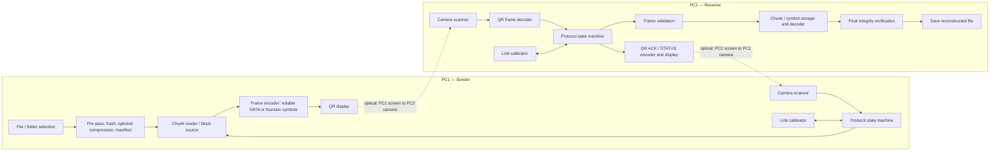
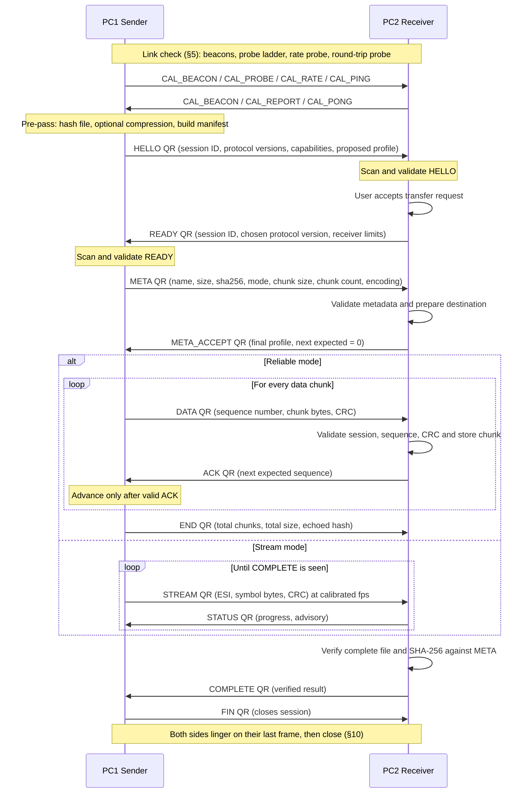
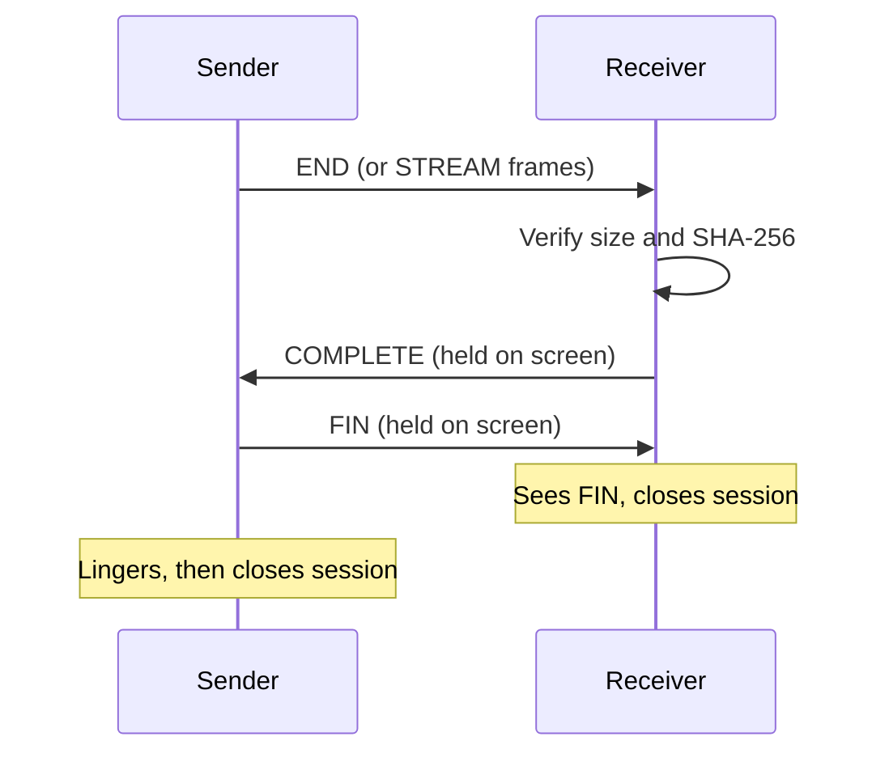
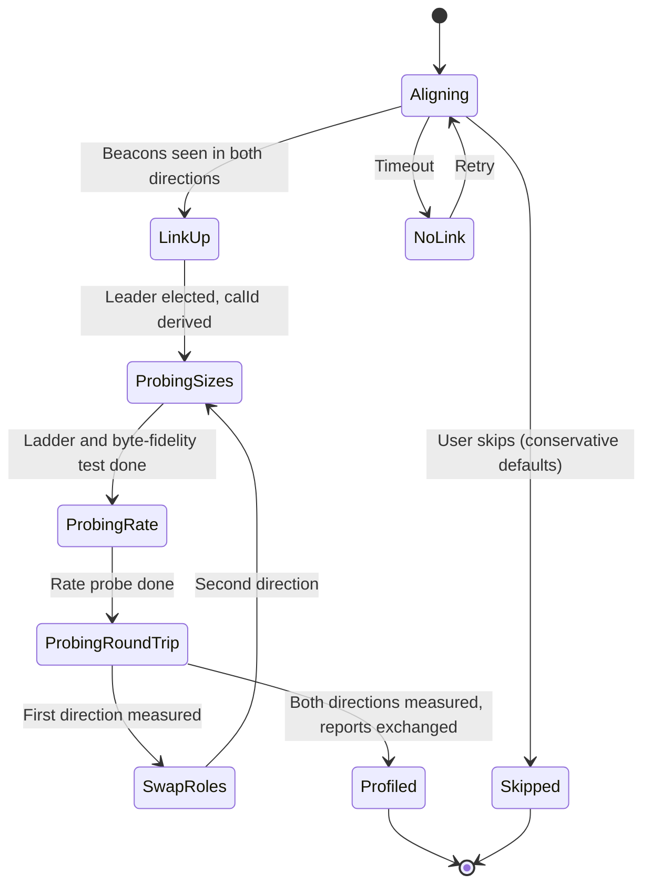
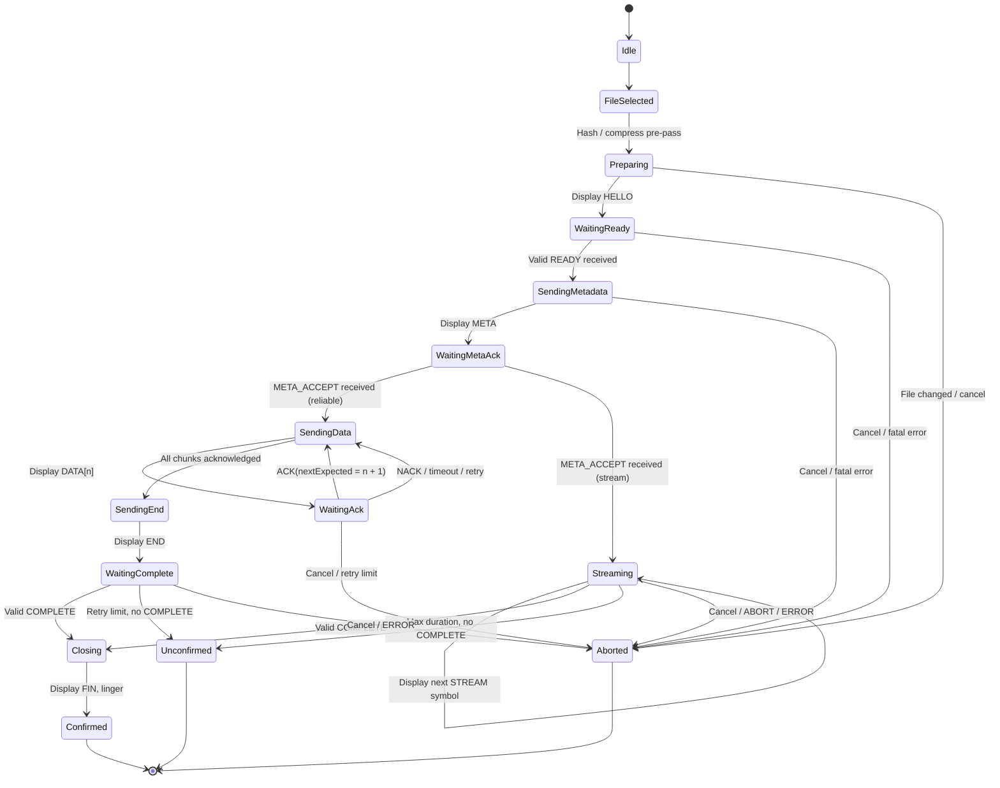
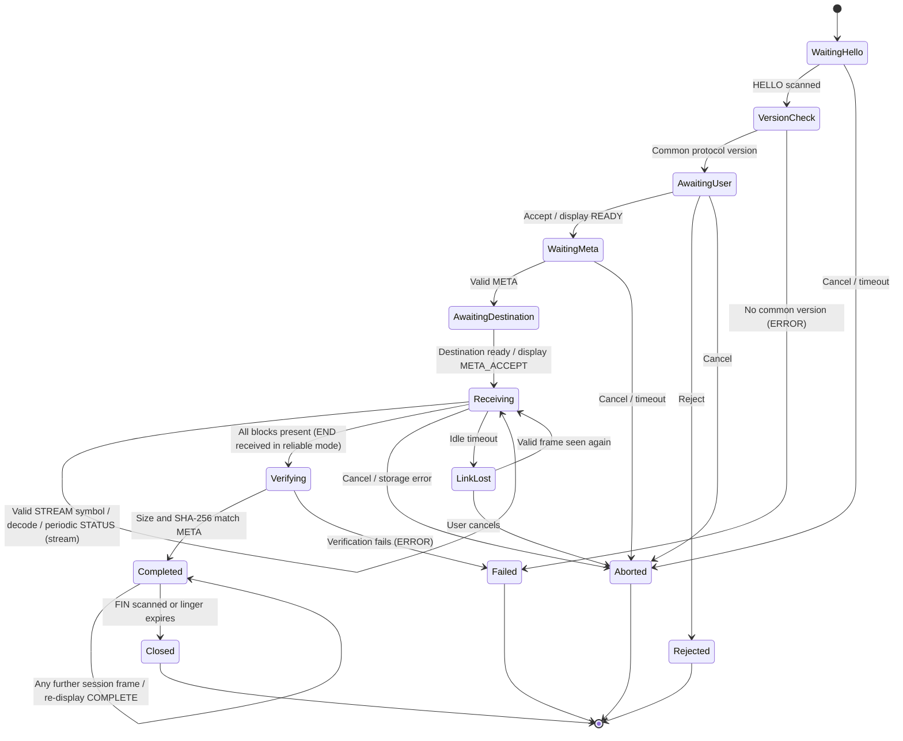

# QRRelay

> **Offline file transfer between computers using QR codes, cameras, and displays.**
>
> Working title: **QRRelay**  
> Project status: **Design / pre-implementation specification (revision 2)**  
> Protocol version: **1.0 (proposed)**

QRRelay is an experimental peer-to-peer file-transfer system in which two computers exchange data optically. Each computer displays QR codes on its screen and uses its camera to scan QR codes displayed by the other computer. The file is divided into small chunks, encoded into a sequence of QR frames, transferred over the optical link, and reconstructed by the receiving computer.

The intended result is a system that can transfer arbitrary files between two computers **with no Wi-Fi, Ethernet, Bluetooth, or internet connection of any kind — neither between the two computers nor to the outside world.** Each computer runs its own locally installed copy of the application. Once the application is on a machine, it needs nothing else: the transfer data travels only through the screens and cameras.

---

## 0. Revision notes

This revision keeps the original protocol-first approach and adds the following. Section numbers refer to this document.

| Change | Where |
|---|---|
| Offline-first delivery is now a core requirement: every PC runs its own local copy; no network, CDN, or server is ever needed at runtime. Includes a build matrix, enforceable requirements, a CSP "no network" guarantee, and an offline acceptance test. | §1.4, §15 |
| New **link calibration and alignment phase** that runs before pairing and selects chunk size, QR error correction, frame encoding, display rate, and transfer mode from measurements. | §5 |
| New **stream mode** (fountain-coded, ACK-free data flow) alongside the original stop-and-wait **reliable mode**. | §3.5, §9 |
| **Hash resolved:** the SHA-256 is computed in a pre-pass and carried in `META`; `END` only echoes it as a consistency check. | §11.4 |
| **Terminal-state linger** and a closing `FIN` message so a lost `COMPLETE` or `ABORT` cannot leave the other side hanging. | §10 |
| **Version negotiation**, because two offline machines may have different app versions installed. | §6.2, §15.6 |
| Binary frame format, optional compression, and a decoder byte-fidelity self-test. | §7, §11.5 |
| Camera/display engineering details (mirroring, rolling shutter, rendering, wake lock). | §4 |
| Roadmap reordered: offline build pipeline first, calibration before the file transfer, stream mode before encryption. | §20 |
| Expanded tests (stream mode, calibration, offline, version skew). | §19 |

---

## 1. Project idea

### 1.1 The basic setup

There are two computers:

- **PC1 — Sender:** has the file or folder to transfer.
- **PC2 — Receiver:** will reconstruct and save the received data.

The application is **symmetric**: the same build runs on both machines, and the role (Send or Receive) is chosen at runtime. Both computers have:

- A display capable of showing a QR code.
- A camera/webcam capable of scanning the other computer's display.
- The QRRelay application installed or otherwise available locally (see §15).

The computers are positioned so that:

- PC1's camera can see PC2's display.
- PC2's camera can see PC1's display.

This creates two optical directions:

| Direction | Physical channel | Purpose |
|---|---|---|
| PC1 → PC2 | PC1 display → PC2 camera | File data and sender control frames |
| PC2 → PC1 | PC2 display → PC1 camera | Ready messages, acknowledgements, status, errors, and completion responses |

Both machines therefore act as a transmitter and receiver, even though the file itself travels in only one direction in the initial version.

### 1.2 Example transfer

Suppose PC1 wants to send `project.zip` to PC2. Neither computer has any network connection.

1. Both users open QRRelay and position the computers so each camera can see the other screen.
2. Both machines run the **link check** (§5): alignment feedback, then a short calibration that measures what the optical link can reliably carry and proposes a *link profile* (payload size, QR error correction, frame encoding, display rate, transfer mode).
3. PC1 selects `project.zip` and creates a new transfer session. The app hashes the file (pre-pass) and prepares metadata.
4. PC1 displays a **HELLO** QR code.
5. PC2 scans it, recognises the transfer request, and asks the user to accept it.
6. PC2 displays a **READY** QR code.
7. PC1 scans READY and verifies that it belongs to the correct session.
8. PC1 displays **META**; PC2 validates it, prepares storage, and answers **META_ACCEPT**.
9. Data transfer begins in the negotiated mode:
   - **Reliable mode:** PC1 displays one DATA QR at a time and advances only after scanning a valid ACK for that chunk.
   - **Stream mode:** PC1 continuously cycles through fountain-coded frames at the calibrated rate while PC2 periodically displays a progress/status QR. No individual frame needs an acknowledgement.
10. When PC2 has everything it needs, it reconstructs the file and verifies the byte count and SHA-256 hash.
11. PC2 displays **COMPLETE**. PC1 answers with **FIN**. The reconstructed file is made available for saving.

In reliable mode the sender must not advance merely because it displayed a QR code; it advances only after scanning a valid acknowledgement for the current session and chunk. In stream mode the sender never claims success; only the receiver's verified `COMPLETE` ends the transfer successfully.

### 1.3 What QRRelay is — and is not

QRRelay is a custom file-transfer protocol carried over an optical QR-code channel. It borrows reliability ideas from networking protocols:

- Sequence numbers identify chunks and preserve order (reliable mode).
- ACK and NACK messages confirm receipt or request retransmission (reliable mode).
- Erasure coding makes the stream tolerant of missed frames (stream mode).
- Checksums detect damaged frames.
- A final SHA-256 hash verifies the reconstructed file.
- Timeouts, retries, and a defined closing handshake handle missed scans.

It is **not FTP over QR** and does not use TCP/IP to carry the file. FTP is an application protocol that normally operates over a network transport. QRRelay instead defines its own messages and reliability behaviour for a low-bandwidth visual channel. No socket, FTP server, WebSocket, or network connection between the two computers is required.

### 1.4 The offline-first principle

"Works offline" is a design requirement, not a side effect. It means all of the following:

1. **No internet needed at runtime.** After the app is installed or copied to a machine, launching it and completing a transfer must not require any network request.
2. **No network between the two computers.** The optical link is the only channel.
3. **Each PC loads its own local copy.** The two computers never need to share a web origin, a server, or an HTTPS address. Each copy only needs to be a *secure context* on its own machine (for example `http://localhost`, an installed PWA, or a desktop wrapper) so the browser permits camera access.
4. **No runtime third-party resources.** No CDN scripts, web fonts, remote WASM, analytics, or update pings. Everything the app needs is in the build.
5. **Provable, not just intended.** The app ships a Content-Security-Policy that forbids network connections, and the project has an automated and a manual offline acceptance test (§15.7).
6. **Version skew is expected.** Because machines are updated by hand, the two copies may be different versions. The protocol negotiates versions and fails clearly when they are incompatible (§6.2).

The one thing offline mode cannot do is deliver the app itself to a machine that has never had it. Each computer must receive the app beforehand (USB stick, one-time online install, installer, etc.). See §15.5.

---

## 2. Goals and non-goals

### 2.1 Goals

1. Transfer arbitrary binary files, not just text or images.
2. Transfer files between two computers using only their screens and cameras.
3. **Run with no internet access and no network between the computers, from a locally installed copy on each machine.**
4. **Measure the optical link before transferring and choose transfer parameters from real measurements.**
5. Use a bidirectional visual control channel so that the sender knows the state of the receiver.
6. Offer two transfer modes: a simple, strictly verifiable **reliable mode** (stop-and-wait) and a faster **stream mode** (fountain-coded) for practical file sizes.
7. Detect missing, duplicated, out-of-order, and corrupted frames.
8. Reconstruct the exact original file and verify it before declaring success.
9. Support large files without requiring the entire sender file to be loaded into memory at once.
10. Provide a clear browser UI for linking, sending, receiving, progress, errors, pause, resume, and cancellation.
11. Support folders by packaging them as ZIP archives in the first release.
12. Close sessions cleanly so that a lost final frame never leaves one side hanging or falsely claiming success.

### 2.2 Non-goals for the first release

- Competing with Wi-Fi, Ethernet, USB, or Bluetooth transfer speeds.
- Supporting multiple receivers in one session.
- Simultaneous file transfer in both directions.
- Automatic execution or opening of received files.
- Transparent transfer of arbitrary operating-system permissions, symbolic links, ownership, or special files.
- A cloud relay or central file-storage service.
- FTP compatibility.
- **Bootstrapping the app onto a machine that does not have it.** (A future "carry the app on the optical link" feature is conceivable but out of scope; see §15.5.)

### 2.3 Expected use cases

QRRelay is best suited to experimentation, demonstrations, small-to-medium files, air-gapped or offline environments, and learning about communication protocols. The optical channel is inherently slow. Reliable mode with one-QR-at-a-time acknowledgements can make even moderate files take a long time; stream mode is intended to make moderate files practical. Very large files may still be impractical.

A future hybrid mode could use QR codes to pair computers and exchange session keys, then transfer the actual payload over a faster network channel. That would be a separate mode; it would not be the QR-only transfer described here.

---

## 3. Core architecture

### 3.1 High-level architecture



The diagram shows the main data path. The actual application should separate the protocol from the UI and camera code so that protocol behaviour can be tested without physical cameras.

Both machines run the same build. Nothing in the diagram touches a network.

### 3.2 Main software modules

| Module | Responsibility |
|---|---|
| `FileManager` | Select files, read file slices, package folders, and expose file metadata. |
| `ManifestBuilder` | Build the transfer manifest: names, sizes, chunk size, total chunks, hash, encoding, mode. |
| `Chunker` | Divide a file or archive into ordered chunks / source blocks. |
| `Compressor` | Optional deflate compression with an "is it worth it" check. |
| `FrameProtocol` | Create, parse, and validate all message types (text and binary frames). |
| `QrEncoder` | Render an outgoing protocol frame as a QR code at an exact integer pixel scale. |
| `QrScanner` | Read the other computer's screen through the local camera and decode QR frames. |
| `LinkCalibrator` | Run alignment feedback, probe ladders, and rate probes; produce a `LinkProfile`. |
| `FountainCodec` | Encode source blocks into stream-mode symbols (sender) and decode them (receiver). |
| `TransferController` | Maintain the sender/receiver state machine, timers, retries, and progress. |
| `ReceiverStorage` | Persist accepted chunks/symbols and write or assemble the output file. |
| `IntegrityVerifier` | Validate per-frame CRC and final SHA-256 (incremental hashing). |
| `SessionManager` | Create session IDs, manage pairing, version negotiation, expiry, reset, and cancellation. |
| `WakeLockManager` | Keep the screen awake and warn about display-affecting OS settings. |
| `OfflineGuard` | Report offline-readiness status (cached app, CSP active, no pending network use). |
| `UI` | Show the QR, camera preview, link quality, connection state, progress, and error messages. |

### 3.3 Recommended implementation stack

A practical first implementation is a browser application:

| Area | Suggested technology | Reason |
|---|---|---|
| Language | TypeScript | Safer handling of protocol message types, byte arrays, and state transitions. |
| Build tool | Vite | Simple static build; supports both a normal PWA build and a single-file build. |
| UI | React, or plain TypeScript if preferred | React is convenient for the role-based dashboards; the protocol must not depend on React. |
| Camera | `navigator.mediaDevices.getUserMedia()` | Browser camera access. |
| QR decoding | Native `BarcodeDetector` where available, with a bundled `@zxing/browser` (QR-specific reader) or `jsQR` fallback | The native detector is fast on supporting browsers; the bundled fallback makes behaviour consistent everywhere. **Never depend on a remote decoder.** |
| QR encoding | A bundled QR library with explicit control over version, mask, error-correction level, and byte-mode segments (for example a Nayuki-style API) | Needed for deterministic rendering and binary payloads. |
| ZIP support | `fflate` or another bundled browser ZIP library | Package selected folders and multiple files. |
| Compression | `CompressionStream('deflate-raw')` where available, otherwise `fflate` | Optional payload compression. |
| Hashing | A bundled incremental SHA-256 (for example `hash-wasm` or `@noble/hashes`) | Web Crypto digests are one-shot; large files need streaming. Must be bundled, not fetched. |
| Erasure coding | A small in-house LT/fountain implementation first; evaluate RaptorQ (RFC 6330) later | See §9. |
| Temporary state | IndexedDB, optionally OPFS | Store received chunks and session metadata. |
| File output | File System Access API when available; Blob download fallback | Write the reconstructed result to disk. |
| Offline app shell | Service worker / PWA **and** a single-file HTML build | Two offline delivery routes from one source tree (see §15). |
| Screen wake | Screen Wake Lock API (feature-detected) | Prevent the display from sleeping mid-transfer. |

Keep the protocol engine framework-independent. It should accept decoded frames and emit the next frame to display. That makes it possible to test it with unit tests, simulated scanners, or prerecorded QR images before connecting real cameras.

All dependencies must be vendored into the build. A CI check should fail the build if any production bundle contains a remote URL that is fetched at runtime.

### 3.4 Suggested project structure

```text
qr-relay/
├── public/
│   ├── icons/
│   └── manifest.webmanifest
├── src/
│   ├── app/
│   │   ├── App.tsx
│   │   ├── routes.tsx
│   │   └── state.ts
│   ├── components/
│   │   ├── CameraPreview.tsx
│   │   ├── QrDisplay.tsx
│   │   ├── LinkQualityPanel.tsx
│   │   ├── TransferProgress.tsx
│   │   ├── FilePicker.tsx
│   │   ├── OfflineStatus.tsx
│   │   └── StatusPanel.tsx
│   ├── camera/
│   │   ├── cameraManager.ts
│   │   ├── qrScanner.ts
│   │   └── wakeLock.ts
│   ├── qr/
│   │   ├── encode.ts
│   │   ├── decode.ts
│   │   └── render.ts
│   ├── calibration/
│   │   ├── alignment.ts
│   │   ├── probeLadder.ts
│   │   ├── rateProbe.ts
│   │   ├── byteFidelity.ts
│   │   └── linkProfile.ts
│   ├── protocol/
│   │   ├── constants.ts
│   │   ├── frame.ts
│   │   ├── frameBinary.ts
│   │   ├── messageTypes.ts
│   │   ├── checksum.ts
│   │   ├── session.ts
│   │   ├── versioning.ts
│   │   ├── sender.ts
│   │   ├── receiver.ts
│   │   ├── reliableMode.ts
│   │   ├── streamMode.ts
│   │   ├── termination.ts
│   │   └── stateMachine.ts
│   ├── fountain/
│   │   ├── prng.ts
│   │   ├── degreeDistribution.ts
│   │   ├── encoder.ts
│   │   └── decoder.ts
│   ├── transfer/
│   │   ├── chunker.ts
│   │   ├── manifest.ts
│   │   ├── fileReader.ts
│   │   ├── receiverStorage.ts
│   │   ├── zipManager.ts
│   │   ├── compression.ts
│   │   └── integrity.ts
│   ├── storage/
│   │   ├── database.ts
│   │   ├── sessionStore.ts
│   │   └── profileStore.ts
│   ├── workers/
│   │   ├── zip.worker.ts
│   │   ├── hash.worker.ts
│   │   └── decode.worker.ts
│   ├── styles/
│   └── main.tsx
├── build/
│   ├── csp.ts                  # generates the Content-Security-Policy (hashes for the single-file build)
│   ├── check-no-remote.ts      # fails CI if the bundle references remote runtime resources
│   └── single-file.config.ts   # single-file build configuration
├── tests/
│   ├── protocol/
│   ├── fountain/
│   ├── calibration/
│   ├── transfer/
│   ├── offline/                # offline acceptance tests (see §15.7)
│   └── fixtures/
├── README.md
├── package.json
└── vite.config.ts
```

### 3.5 Transfer modes

QRRelay has two data-transfer modes. Both share the same calibration, pairing, metadata, verification, and termination rules. They differ only in how data frames flow.

| | **Reliable mode** | **Stream mode** |
|---|---|---|
| Data frames | `DATA` frame with a sequence number | `STREAM` frame with an encoding-symbol ID (ESI) |
| Feedback | Per-chunk `ACK`/`NACK` from the receiver | Periodic advisory `STATUS`; no per-frame ACK |
| Sender display | One QR held until the matching ACK is scanned | QR changes at a fixed calibrated rate and loops indefinitely |
| Handling of missed scans | Retransmit the same chunk | Ignore: any sufficient set of symbols reconstructs the file |
| Complexity | Low — easy to reason about and test | Higher — needs an erasure-code implementation |
| Speed | Slowest (one round trip per chunk) | Potentially an order of magnitude faster; measure it |
| Role | Baseline, test oracle, fallback, calibration-poor links | Default for files where speed matters, once implemented |

Reliable mode is implemented first and is always kept as a fallback. Stream mode is selected when calibration shows the link can sustain a sensible display rate and the receiver supports it.

---

## 4. Physical communication model

### 4.1 Two-way optical link

Each PC runs both of these functions at the same time:

- **Display function:** show the current outgoing QR frame.
- **Scanner function:** continuously inspect camera frames for a valid QR frame from the other PC.

For a PC1-to-PC2 transfer:

- PC1's display is the data transmitter.
- PC2's camera is the data receiver.
- PC2's display is the acknowledgement/status transmitter.
- PC1's camera is the acknowledgement/status receiver.

The camera preview can be shown in a small part of the UI while the QR code occupies most of the screen. Users should be able to pause scanning, select another camera, and manually retry camera permission.

### 4.2 Camera and display requirements

- Use a camera with a stable focus and sufficient resolution.
- Keep the other computer's QR code fully visible in the camera view.
- Display QR codes at a large size with a white quiet zone around them.
- Use a black QR pattern on a plain white background; avoid gradients, logos, animation inside the code, or decorative styling.
- Render each QR **at an exact integer number of screen pixels per module** (draw to a `<canvas>` and set `image-rendering: pixelated`). Fractional scaling blurs module edges and hurts decoding.
- Avoid glare, reflections, severe viewing angles, and very low monitor brightness. Raise screen brightness and disable night-light/blue-light filters and dark-mode colour inversion on the page.
- Keep the QR frame unchanged until the protocol allows it to change (reliable mode: until the matching response; stream mode: until the next scheduled frame).
- Allow the user to choose the camera device. Some computers expose more than one camera.
- Use a camera resolution such as 1280×720 where supported, but do not assume every webcam can resolve a dense QR code at every distance.
- Request manual or locked focus/exposure through `MediaStreamTrack.applyConstraints()` where supported, and fall back gracefully. Continuous auto-focus and auto-exposure can "hunt" when the scene changes.

The app should show a clear instruction if it cannot obtain camera access. Browser camera access generally requires a secure context (see §15.8) and explicit user permission.

### 4.3 Practical setup

1. Open QRRelay on both computers.
2. Place the computers so their webcams can see the opposite display.
3. Run the **link check** (§5) on both computers and adjust distance, angle, and QR size until the alignment indicator is green in both directions.
4. On PC1, select **Send** and choose the file.
5. On PC2, select **Receive**.
6. Start the pairing sequence.

**Laptop geometry.** A laptop webcam sits above its own screen and looks roughly along the screen's normal. Two laptops placed facing each other with ordinary lid angles often cannot see each other's displays. Common workable arrangements are: laptops side by side and angled inward, one laptop's lid tilted back so its camera points down at the other's screen, or an external USB webcam on a small stand. Add photos or diagrams of known-good arrangements to the user documentation.

If a desktop PC does not have a webcam, an external USB webcam can be used. A phone could also act as a scanning device in a future client, but that is outside the two-computer first release.

### 4.4 Camera and decode pipeline

- Decode **unmirrored** frames. The user-facing preview may be mirrored for comfort, but the decoder must receive the raw, unmirrored camera image.
- Run decoding off the main thread (`decode.worker.ts`) and drive it with `requestVideoFrameCallback()` where available so every new camera frame is considered exactly once.
- **Rolling shutter and tearing.** A camera may capture a display mid-update, producing an image that is part old QR and part new QR. Such frames fail to decode; treat them as ordinary loss. In stream mode, hold each QR for at least two camera frame intervals (§9.5) as a starting heuristic, and validate it during calibration.
- **Moiré.** Photographing a screen can produce interference patterns that depend on distance and angle. If decoding is unstable, change distance or angle slightly rather than increasing QR density.
- **Scanner-layer duplicate suppression.** The same QR will be decoded hundreds of times while it stays on screen. The scanner may suppress identical consecutive decodes for efficiency, but the protocol must still handle duplicates (§8.2), because suppression must never be relied on for correctness.
- **Binary fidelity.** Some decoders expose a text string rather than raw bytes. Never assume arbitrary binary survives a decoder's text API; run the byte-fidelity self-test (§5.5) before enabling binary frames.
- **Keep awake and foregrounded.** Request a screen wake lock when a session starts, and keep the tab visible and focused. Background tabs may be throttled, and sleeping displays stop the transfer. Warn the user if the page loses visibility.

---

## 5. Link calibration and alignment

The link check runs **before pairing and before any file is chosen**. Its job is to answer two questions with measurements instead of guesses: *Can the two computers see each other at all?* and *What can this particular pair of screens and cameras reliably carry?*

### 5.1 Principles

- **Symmetric and role-free.** Both computers run the same procedure. Roles for calibration (probe leader and follower) are assigned automatically from device nonces; the user does not choose Send/Receive yet.
- **Non-committal.** Calibration frames carry no file information and use a separate calibration ID. Nothing about a transfer is decided or stored.
- **Measured, not assumed.** The result is a `LinkProfile` (§5.7) that the sender uses to propose chunk size, error correction, frame encoding, display rate, and mode.
- **Skippable, but not silently.** The user can skip calibration and run on conservative defaults, with a visible warning (§5.11).
- **Both directions matter.** Each direction of the link (PC-A → PC-B and PC-B → PC-A) can have different quality, so each is measured separately.

### 5.2 Phase A — Alignment and link-up (beacons)

Each computer displays a **`CAL_BEACON`** QR and scans for the other's beacon. A beacon payload contains:

```json
{
  "app": "QRRelay",
  "appVersion": "0.4.1",
  "protocols": [1],
  "nonce": "128-bit random hex, generated at launch of the link check",
  "seen": "peer nonce this device last decoded, or null",
  "caps": { "frameEncodings": ["text", "binary"], "modes": ["reliable", "stream"] }
}
```

Before a shared calibration ID exists, beacons use the all-zero session ID (`00000000000000000000000000000000`). The parser accepts the all-zero ID only for `CAL_BEACON`.

The `seen` field makes link state observable from both ends:

1. Each side shows its own beacon and keeps scanning.
2. When a device decodes the peer's beacon, it records the peer's `nonce` and puts it in its own beacon's `seen` field.
3. The link is **up in both directions** when each device has decoded a beacon whose `seen` equals its own nonce.

The alignment UI shows, for each direction:

- The camera preview with a highlighted bounding box around any detected QR code.
- The decode rate (successful decodes per second) and a simple quality bar.
- Plain-language guidance: *"Move closer"*, *"Reduce glare"*, *"Increase brightness"*, *"Hold still"*, *"Peer can see you — waiting for your camera to see the peer"*.
- The peer's `appVersion` and `protocols`, so version problems appear immediately (§6.2).

### 5.3 Calibration ID and leader election

Once both nonces are known, both devices derive the same calibration ID without sending anything:

```text
calId = first 16 bytes of SHA-256( smallerNonce || largerNonce )   // hex-encoded, 32 chars
```

The device with the numerically larger nonce is the **leader** for the first half of calibration (it sends probes and the follower measures), then the roles swap. Both halves use `calId` as their session ID. Calibration frames from any other ID are ignored.

### 5.4 Phase B — Probe ladder (payload size, error correction, encoding)

The probe sender displays a ladder of `CAL_PROBE` frames of increasing density, each held on screen for a configurable window (for example 1.5–3 s). The default ladder is a grid, pruned as it runs:

| Axis | Default values |
|---|---|
| Raw payload bytes | 128, 256, 384, 512, 768, 1024 |
| QR error correction | M, Q |
| Frame encoding | text (Base64URL), binary |

Probe content is a **deterministic pseudo-random byte sequence derived from the probe index**, so the measuring side can check the decoded bytes exactly, without any extra information being sent. This measures byte-exact decoding, not merely "a QR was detected."

For each probe, the measuring side records:

- Whether the decoded bytes were exactly correct.
- The number of distinct camera frames that decoded correctly while the probe was on screen, compared with the number of camera frames examined (a **stability score**).
- Time from the probe appearing to the first correct decode (decode latency).

A probe **passes** when its stability score is above a configurable threshold (for example, at least half the examined frames decode correctly). The ladder stops climbing for a given EC level and encoding after two consecutive larger sizes fail. The thresholds above are starting points to be tuned from physical testing (§19.4).

### 5.5 Byte-fidelity self-test

Before binary frames are allowed, a dedicated binary probe checks that the decoder and QR encoder pair preserve arbitrary bytes. Its payload includes:

- Every byte value from `0x00` to `0xFF`.
- Byte sequences that are **invalid UTF-8** (for example `0xC0 0x80`, a lone `0xFF`, a truncated multi-byte sequence).
- A run of `0x00` bytes and a run of `0xFF` bytes.

If the decoded bytes are not identical, binary frames are disabled for this pair and the profile falls back to text/Base64URL. This is the guard against decoder APIs that return text strings.

### 5.6 Phase C — Rate probe and round-trip probe

**Rate probe (stream-mode viability).** The probe sender displays numbered `CAL_RATE` frames at candidate display rates (for example 2, 4, 6, 8, and 12 frames per second, a few seconds each) using the best payload size found in Phase B. The measuring side counts how many *distinct* frame numbers it decoded and reports the loss rate at each display rate.

For each candidate rate:

```text
goodput(fps) = fps × payloadBytes × (1 − lossRate)
```

The selected `displayFps` is the rate with the highest goodput, then backed off by one step as a safety margin (unless it is already the lowest tested rate). Because stream mode tolerates frame loss but not an unreadable channel, a rate whose loss rate exceeds a configured maximum is never selected.

**Round-trip probe (reliable-mode timing).** The probe sender displays `CAL_PING(n)`; the other side answers with `CAL_PONG(n)`. After a number of exchanges, both sides know the median and 95th-percentile round-trip times. These produce the default `ackTimeoutMs` (for example, a multiple of the 95th percentile, clamped to sensible limits) and the estimated reliable-mode throughput.

### 5.7 The link profile

Each side measures the direction it *receives* and reports it to the peer in a `CAL_REPORT` frame (so the reports also exercise the return channel). The reports are combined into a `LinkProfile` that both screens display. Because roles are not yet chosen, profile values are stored per direction:

```json
{
  "profileVersion": 1,
  "directions": {
    "leaderToFollower": {
      "payloadBytes": 512,
      "frameEncoding": "binary",
      "ecLevel": "Q",
      "displayFps": 5,
      "lossRate": 0.12,
      "decodeLatencyMsP50": 240
    },
    "followerToLeader": {
      "payloadBytes": 512,
      "frameEncoding": "binary",
      "ecLevel": "Q",
      "displayFps": 5,
      "lossRate": 0.09,
      "decodeLatencyMsP50": 210
    }
  },
  "roundTripMs": { "p50": 900, "p95": 1800 },
  "ackTimeoutMs": 4000,
  "ackEcLevel": "H",
  "recommendedMode": "stream",
  "estimatedGoodputBytesPerSecond": { "reliable": 480, "stream": 2100 }
}
```

When the user later selects Send on one machine, that machine's outgoing direction supplies the data-frame parameters. The receiver's outgoing (ACK/STATUS) frames are tiny and always use a conservative size and a higher error-correction level (`ackEcLevel`), because the sender must be able to read them even when conditions are poor.

The numbers above are illustrative, not promises.

### 5.8 Agreement rules

- The sender **proposes** a profile in `HELLO` (derived from calibration, or defaults if skipped).
- The receiver may only make the profile **more conservative**: smaller payload, higher error-correction level, lower display rate, or reliable instead of stream. It may never raise a value.
- The final profile is stated in `META` and confirmed in `META_ACCEPT`. Neither side changes parameters mid-transfer without a defined renegotiation (§13.3).

### 5.9 What the user sees

- A link-quality summary: **Good**, **Fair**, **Poor**, or **No link**.
- The recommended mode and an estimated transfer time for the selected file, labelled as an estimate.
- Plain-language problems with suggested fixes.
- An "Advanced" panel to override mode, payload size, error-correction level, and display rate, with a warning when the override is above what calibration measured.

If the link is **Poor**, the app should recommend reliable mode with small payloads, and should not enable stream mode unless the user explicitly overrides it.

### 5.10 Storing and reusing the profile

A successful profile may be stored locally (IndexedDB) and keyed by the selected camera device label, screen resolution, and device pixel ratio. On a later run the app offers a **Quick check** (roughly ten seconds: one probe at the stored size plus a short rate sample) that confirms the stored profile still works, instead of repeating the full ladder. Stored profiles expire and are discarded whenever the quick check fails. Profiles are local to the machine; nothing is uploaded anywhere.

### 5.11 Failure and skipping

If the link cannot be established, the app shows a troubleshooting checklist (distance, glare, brightness, camera focus, lid angle, camera selection, page visibility). If the user skips calibration, the app starts with **conservative defaults** — reliable mode, text frames, 384-byte chunks, error-correction level Q, a generous timeout — and displays a notice that speed has not been optimised.

### 5.12 Time budget

The full link check should aim to complete in roughly one to two minutes on a good link. If it takes much longer, the app should offer to continue with the best result so far rather than keep probing.

---

## 6. Transfer protocol

### 6.1 Protocol design principle

The protocol has two data modes (§3.5). **Reliable mode** uses **stop-and-wait ARQ** (automatic repeat request): the sender transmits one data frame and waits for the receiver to acknowledge it before transmitting the next one. **Stream mode** uses an erasure code so that the receiver can reconstruct the file from any sufficiently large set of received frames.

Reliable mode is deliberately conservative. It gives the first implementation simple, testable rules for ordering, retransmission, and duplicate handling, and it remains the reference behaviour against which stream mode is tested. Windowed or piggybacked variants can be added after the basic system works (§8.6).

### 6.2 Versioning and capability negotiation

Two offline machines will often run different builds, so version negotiation is part of pairing.

- Every build declares the list of **protocol versions** it supports (for example `[1]`), plus an informational `appVersion` and build identifier.
- `CAL_BEACON` and `HELLO` carry this information, so a mismatch is visible as early as the link check.
- The sender's `HELLO` lists supported protocol versions. The receiver's `READY` names the **highest version they both support**.
- If there is no overlap, both sides show an explicit error — for example *"PC1 supports protocol versions 1; PC2 supports 2–3. Update the older copy"* — and the session ends with `ERROR(VERSION_MISMATCH)`.
- Unknown JSON fields are ignored. Unknown **required** message types or unsupported frame magic are rejected.
- Capabilities (`modes`, `frameEncodings`, `compression`, `maxFileSize`, `maxPayloadBytes`) are negotiated the same way: the effective setting is the intersection.

### 6.3 Message types

| Message | Direction | Mode | Purpose |
|---|---|---|---|
| `CAL_BEACON` | Both | Calibration | Show presence, nonce, versions, and what this device has seen. |
| `CAL_PROBE` | Probe sender → measurer | Calibration | Deterministic test payload for size/EC/encoding probing and byte-fidelity test. |
| `CAL_RATE` | Probe sender → measurer | Calibration | Numbered frames for display-rate loss measurement. |
| `CAL_PING` / `CAL_PONG` | Both | Calibration | Round-trip time measurement. |
| `CAL_REPORT` | Measurer → probe sender | Calibration | Report measured results for the direction it received. |
| `HELLO` | Sender → Receiver | Both | Announce a new session, supported versions, capabilities, and proposed link profile. |
| `READY` | Receiver → Sender | Both | Accept pairing, select protocol version, and advertise receiver limits. |
| `META` | Sender → Receiver | Both | Send file or bundle metadata, including the authoritative SHA-256 and the final transfer parameters. |
| `META_ACCEPT` | Receiver → Sender | Both | Accept the metadata and prepare storage. Contains `nextExpected = 0` in reliable mode. |
| `DATA` | Sender → Receiver | Reliable | Carry one file-data chunk. |
| `ACK` | Receiver → Sender | Reliable | Confirm a chunk; indicate the next expected sequence number. |
| `NACK` | Receiver → Sender | Reliable | Request retransmission or identify the next expected sequence number. |
| `STREAM` | Sender → Receiver | Stream | Carry one fountain-coded symbol identified by its encoding-symbol ID (ESI). |
| `STATUS` | Receiver → Sender | Stream | Advisory progress report (decoded block count, optionally a bitmap). Never required for correctness. |
| `END` | Sender → Receiver | Both | Declare that the sender has sent everything; echo the hash and sizes as a consistency check. |
| `COMPLETE` | Receiver → Sender | Both | Confirm that size and final hash verification succeeded. |
| `FIN` | Sender → Receiver | Both | Confirm the sender saw `COMPLETE`; closes the session (§10). |
| `ABORT` | Either direction | Both | Cancel the session. Displayed for a linger period (§10). |
| `PAUSE` / `RESUME` | Either direction | Both | Optional later controls for pausing and continuing a session. |
| `ERROR` | Either direction | Both | Report an unrecoverable protocol, storage, or version error. |

All session messages must include the protocol version and session ID. A message from a different or expired session must be ignored. The only exception is `CAL_BEACON`, which uses the all-zero session ID (§5.2).

### 6.4 Full handshake and transfer sequence



### 6.5 Detailed steps

#### Step 0 — Link check

The link check (§5) completes, or the user explicitly skips it. The result is a link profile held in memory for the session.

#### Step 1 — Create session and run the sender pre-pass

PC1 creates a cryptographically random 128-bit session ID using `crypto.getRandomValues()`. It records the selected file or bundle, its size, and its name.

PC1 then runs a **pre-pass** over the file (in a worker, with a progress indicator):

1. Compute the SHA-256 of the original bytes using an incremental hash. This is quick compared with the optical transfer time (local disk and CPU rates are many orders of magnitude faster than the QR channel).
2. Decide whether compression is worthwhile (§11.5) and, if so, produce the compressed stream.
3. Record the file's identity (size and last-modified time) so a change during the transfer can be detected and the session aborted.

PC1 displays HELLO. HELLO should include:

- Protocol magic and the list of supported protocol versions.
- Session ID.
- Sender role.
- Supported modes, frame encodings, and compression methods.
- The proposed link profile (§5.8).
- Optional public-key information for a future encrypted mode.

#### Step 2 — Receiver accepts

PC2 scans HELLO and checks the protocol versions and session ID. It displays the proposed sender and transfer type and asks the user to accept or reject the request.

After acceptance, PC2 displays READY. READY includes the same session ID, the selected protocol version, receiver role, receiver limits (maximum file size, maximum payload size, supported modes), and any parameter reductions (§5.8).

PC1 scans READY. If its session ID does not match the active session, it ignores the message. If it matches, pairing is complete.

#### Step 3 — Send metadata

PC1 sends META. The metadata describes what PC2 is about to receive and fixes all transfer parameters. For a single file:

```json
{
  "name": "project.zip",
  "kind": "file",
  "mimeType": "application/zip",
  "size": 1048576,
  "sha256": "hex-encoded-sha256-of-the-original-bytes",
  "encoding": "identity",
  "transferSize": 1048576,
  "mode": "stream",
  "frameEncoding": "binary",
  "ecLevel": "Q",
  "chunkSize": 512,
  "totalChunks": 2048,
  "displayFps": 5,
  "encryption": "none"
}
```

Field notes:

- `size` is the byte length of the original file. `sha256` is the hash of those original bytes and is **authoritative** (§11.4).
- `encoding` is `identity` or a compression method (for example `deflate-raw`). `transferSize` is the number of bytes actually chunked and sent; it equals `size` for `identity`.
- `totalChunks = ceil(transferSize / chunkSize)`. In stream mode this is the number of source blocks `K`.
- `displayFps` applies only to stream mode.
- The values above are an illustrative example, not required fixed values.

The receiver must validate the filename, size, chunk count, mode, and all limits before accepting the transfer. PC2 asks the user to accept the incoming file and choose or confirm the destination. It then sends META_ACCEPT carrying the final (possibly reduced) profile, with `nextExpected = 0` in reliable mode.

#### Step 4a — Reliable mode: transfer data chunks

PC1 reads the file in slices rather than reading the entire file into memory. For sequence number `n`, it reads the corresponding range and creates a DATA frame.

PC1 keeps that exact frame as the current in-flight frame until it receives a matching ACK. PC2 validates and stores the frame before sending its acknowledgement. See §8.

#### Step 4b — Stream mode: transfer symbols

PC1 begins cycling through STREAM frames at the negotiated display rate. It continues until it scans a valid COMPLETE or the user cancels (or a configured maximum duration elapses). PC2 decodes symbols as they are captured and periodically displays an advisory STATUS frame. See §9.

#### Step 5 — Finish and verify

In reliable mode, after every chunk has been acknowledged, PC1 sends END. END includes the expected number of chunks, total byte counts, and **echoes** the SHA-256 from META as a consistency check. In stream mode the receiver does not need END to start verifying; it verifies as soon as it has reconstructed all source blocks. (The sender may still display END if it is configured to stop streaming, but the receiver's decoder completion is the trigger.)

PC2 checks:

1. Every required block/sequence number was received.
2. If compression was used, the data decompresses cleanly.
3. The reconstructed output has the expected byte length (`size`).
4. The SHA-256 of the reconstructed file matches the `sha256` from META. If END was received, its echoed hash must equal META's; any disagreement aborts the transfer with an error.
5. The file can be finalised in the selected storage destination.

Only after all checks succeed does PC2 display COMPLETE. A progress bar reaching 100% is not itself proof that a file is correct; final integrity verification is mandatory.

#### Step 6 — Close the session

PC1 answers a valid COMPLETE with FIN. Both sides then follow the termination and linger rules in §10.

---

## 7. Frame format

### 7.1 Version 1 text envelope

For the first implementation, use a compact, printable text envelope. This is easier to debug and is compatible with camera decoders that return decoded QR text. Arbitrary file bytes are represented as Base64URL inside DATA and STREAM frames.

Proposed frame format:

```text
QRF1|TYPE|SESSION_ID|SEQUENCE|PAYLOAD_BASE64URL|CRC32
```

Fields:

| Field | Meaning |
|---|---|
| `QRF1` | Fixed protocol magic and version marker. |
| `TYPE` | Message type, for example `HELLO`, `READY`, `META`, `DATA`, `ACK`, `NACK`, `STREAM`, `STATUS`, `END`, `COMPLETE`, `FIN`, `ABORT`, or a `CAL_*` type. |
| `SESSION_ID` | 32-character lowercase hexadecimal session identifier (128 bits). The all-zero value is valid only for `CAL_BEACON`. |
| `SEQUENCE` | Unsigned decimal number. For DATA, the chunk sequence. For ACK, the next expected DATA sequence. For STREAM, the encoding-symbol ID (ESI). For calibration probes, the probe or frame index. |
| `PAYLOAD_BASE64URL` | Base64URL-encoded payload. Empty if the message has no payload. |
| `CRC32` | Eight-character hexadecimal CRC-32 value over the canonical frame fields and decoded payload. |

Define the CRC input byte-for-byte and use the same implementation on both computers. For version 1, calculate CRC-32/ISO-HDLC (the common IEEE CRC-32 variant; reflected polynomial `0xEDB88320`, initial value `0xFFFFFFFF`, final XOR `0xFFFFFFFF`) over this exact byte sequence: UTF-8 bytes of `QRF1`, one `0x00` byte, UTF-8 bytes of `TYPE`, one `0x00` byte, the 16 session-ID bytes decoded from hexadecimal, one `0x00` byte, the sequence number as an unsigned 32-bit big-endian integer, one `0x00` byte, then the decoded payload bytes. Do not calculate the checksum over an arbitrarily re-serialised JSON object.

The delimiter `|` is safe because Base64URL does not use it. The parser must still validate field count, field lengths, message type, protocol version, session ID syntax, sequence range, payload size, Base64URL validity, and CRC before passing a frame to the state machine.

### 7.2 Payload formats

- `HELLO`, `READY`, `META`, `META_ACCEPT`, `END`, `COMPLETE`, `FIN`, `ABORT`, `ERROR`, and `CAL_BEACON`/`CAL_REPORT`: UTF-8 JSON payloads encoded as Base64URL.
- `DATA` and `STREAM`: raw file (or symbol) bytes encoded as Base64URL.
- `ACK`, `NACK`, and `STATUS`: small JSON payloads or no payload; for `ACK`/`NACK`, the sequence field carries `nextExpected`.
- `CAL_PROBE`, `CAL_RATE`: deterministic test bytes (§5.4).

Example conceptual DATA frame:

```text
QRF1|DATA|0123456789abcdef0123456789abcdef|42|<base64url-encoded-512-byte-chunk>|a1b2c3d4
```

The Base64URL text above is a placeholder. It is not a real payload or checksum.

### 7.3 Binary frames (`QRB1`)

Base64URL adds approximately one-third more characters than the original binary data, and the text envelope repeats a 32-character session ID in every frame. That is acceptable for a first prototype, but it reduces the number of file bytes each QR code can carry.

Once the byte-fidelity self-test passes (§5.5), the high-rate message types may use a compact binary frame encoded directly in QR byte mode:

```text
offset  size  field
0       1     magic/version byte: 0xB1  (binary frame family, version 1)
1       1     type code
2       4     session tag = first 4 bytes of the 128-bit session ID
6       4     sequence / ESI, unsigned 32-bit big-endian
10      2     payload length N, unsigned 16-bit big-endian
12      N     payload
12+N    4     CRC-32 (same variant as §7.1), big-endian, over bytes 0 .. 11+N
```

Type codes: `DATA = 0x10`, `STREAM = 0x11`, `ACK = 0x20`, `NACK = 0x21`, `STATUS = 0x22`.

Rules:

- **Only high-rate frames may be binary:** `DATA`, `STREAM`, `ACK`, `NACK`, `STATUS`. All other messages — calibration beacons, `HELLO`, `READY`, `META`, `META_ACCEPT`, `END`, `COMPLETE`, `FIN`, `ABORT`, `ERROR` — always use the text envelope. Negotiation therefore always happens in the most widely decodable form, and the frame encoding switches only after `META_ACCEPT`.
- The 4-byte session tag is a filter, not an authenticator. The full 128-bit ID was already confirmed during pairing. A stale frame from another session would have to collide on both the tag and the CRC to be accepted; encryption (§14.2) adds real authentication.
- A binary frame decoded through a text API may be corrupted. Do not use binary frames unless the self-test passes for this camera/decoder pair.

### 7.4 Chunk size

When calibration runs, it chooses the chunk size (§5). When calibration is skipped, start with a configurable raw data chunk size around **384–512 bytes** for the text/Base64URL implementation, and tune from physical tests.

The chunk size is a negotiated session parameter. The sender proposes it in HELLO, the receiver may only lower it (§5.8), and the final value is fixed in META.

The theoretical maximum QR capacity is not a sensible default. Capacity depends on QR version, encoding mode, and error-correction level. Larger QR symbols are denser and may be harder for a webcam to decode reliably. Use a conservative payload and tune it with physical tests.

### 7.5 QR error correction and application checks

QR itself uses Reed–Solomon error correction. That helps the scanner recover a QR symbol when part of the image is damaged, but it does not replace application-level validation.

QRRelay should use:

- QR error correction, initially Q or H where payload size permits. Small response frames (`ACK`, `NACK`, `STATUS`) should always use a higher level than data frames.
- CRC-32 per application frame to detect a bad or incorrectly decoded frame.
- SHA-256 over the complete file to verify end-to-end reconstruction.

CRC-32 is for accidental corruption detection, not security. SHA-256 is for final integrity comparison, not encryption.

---

## 8. Reliable mode: ACKs, NACKs, retries, and duplicates

### 8.1 Stop-and-wait rule

At any moment, PC1 may have at most one unacknowledged DATA frame.

If PC1 is sending chunk `n`, it must not send chunk `n + 1` until it has scanned a valid ACK indicating `nextExpected = n + 1`.

This keeps the receiver's expected state simple and prevents the sender from outrunning the receiver.

### 8.2 Receiver sequence rules

Let `nextExpected` be the next DATA sequence number the receiver needs.

| Incoming frame | Receiver action |
|---|---|
| `seq == nextExpected`, valid CRC | Commit chunk to storage, increment `nextExpected`, display ACK with the new value. |
| `seq < nextExpected` | Treat as a duplicate; do not append it again. Re-display ACK with the current `nextExpected`. |
| `seq > nextExpected` | Do not store it. Display NACK with the current `nextExpected`. |
| Invalid CRC | Do not store it and do not trust any of its fields. Leave the currently displayed response unchanged; the sender's timeout will trigger retransmission. (Optionally display a NACK, but only if the session ID parsed and matches the active session.) |
| Wrong session ID | Ignore it. |
| Unknown message type or unsupported version | Reject it or display a protocol error. |

The duplicate rule is important. For example, PC2 may successfully store chunk 12 and display ACK, but PC1 may fail to scan that ACK. PC1 will retransmit chunk 12. PC2 must recognise that it has already stored chunk 12 and acknowledge it again without writing the chunk twice.

### 8.3 ACK behaviour

The receiver keeps its current ACK or NACK QR code on screen until it receives a new valid sender frame or the session is cancelled. This prevents the receiver from replacing an acknowledgement before PC1 has had time to scan it.

The sender only changes its outgoing QR after reading a matching response for the active session and expected sequence. Because `nextExpected` only ever increases, a stale ACK that is scanned late can never cause the sender to skip a chunk: it advances only when the value equals `n + 1`.

ACK and NACK frames are tiny and use a higher QR error-correction level than DATA frames (`ackEcLevel`, §5.7).

### 8.4 Timeouts and retry policy

Use configurable values rather than hard-coded timing assumptions. The default `ackTimeoutMs` comes from the calibration round-trip probe (§5.6); without calibration, use a generous fixed default. Suggested starting behaviour:

- Start an ACK timeout after displaying a DATA QR.
- If no matching ACK or NACK arrives before timeout, keep displaying the same DATA QR and continue scanning for a response.
- If the receiver sends NACK, retransmit the requested chunk.
- Count repeated timeouts and failed attempts.
- After a configurable retry limit (for example, 10 attempts), pause and show a user-visible recovery message rather than silently aborting.
- Let the user retry, pause, or cancel.

The timer should not cause the sender to skip a chunk. Timeouts trigger retransmission, never progression.

### 8.5 Storage rule for acknowledgements

The receiver must not send a successful ACK until it has accepted the frame and committed it to the storage layer (§12). Acknowledging a frame that exists only in a volatile, easily-lost buffer weakens the meaning of ACK.

### 8.6 Optional future variants

Stop-and-wait wastes time because each chunk requires a complete request/acknowledgement cycle. Possible future refinements are:

- **Windowed mode:** PC1 sends several numbered frames before waiting for an ACK bitmap or a cumulative acknowledgement.
- **Piggybacked acknowledgements:** because both optical directions are always live, every frame in each direction could carry the sender's latest view of the peer's state instead of using separate ACK frames.

Stream mode (§9) is the planned speed path. Windowed reliable mode adds buffering, missing-frame tracking, display timing, and selective-retransmission complexity, and much of that is avoided by erasure coding. Do not implement windowed mode before stop-and-wait is correct, and treat it as lower priority than stream mode.

---

## 9. Stream mode (fountain-coded transfer)

### 9.1 Why a second mode

In reliable mode every chunk pays for a complete round trip: display change, camera capture, decode, store, display change, camera capture, decode. Most of that time is latency, not bandwidth. Stream mode removes the per-chunk round trip. The sender simply keeps displaying new frames at a rate the link can sustain; the receiver captures what it can; and an **erasure code** guarantees that it does not matter *which* frames were captured, only that enough distinct ones were.

This is the same idea used by animated-QR file-transfer tools: no frame is individually critical, so a missed scan costs a fraction of a frame's worth of time instead of a retransmission cycle.

### 9.2 Overview

1. The file (after optional compression) is split into `K` equal-size **source blocks** of `chunkSize` bytes. The last block is zero-padded for coding purposes; the true length is `transferSize` from META.
2. The sender produces **encoding symbols**, each identified by an unsigned integer **ESI** (encoding-symbol ID). Each symbol is the XOR of a deterministic subset of source blocks.
3. The sender displays STREAM frames at `displayFps`, cycling indefinitely.
4. The receiver decodes symbols as they are captured. Once it has enough symbols to recover all `K` blocks, it assembles the file and verifies SHA-256.
5. The receiver displays COMPLETE. The sender stops streaming, answers with FIN, and the session closes (§10).
6. While receiving, the receiver periodically displays an advisory STATUS frame. **Correctness never depends on STATUS.**

### 9.3 Choosing the erasure code

**Version 1 recommendation: a systematic LT-style fountain code.**

- **Systematic start.** ESIs `0 … K−1` are the source blocks themselves (degree 1). ESIs `K` and above are repair symbols, each the XOR of a pseudo-randomly chosen subset of source blocks. On a clean link the file completes in roughly `K` frames; losses are repaired by later symbols.
- **Deterministic symbol construction.** For a repair symbol the receiver must be able to regenerate the exact subset of source blocks from the ESI alone. The neighbour set is derived from a **fully specified PRNG** seeded from the session ID and the ESI, combined with a **specified degree distribution** (for example a robust soliton distribution with fixed parameters). The exact PRNG algorithm, seeding rule, distribution parameters, and sampling procedure are part of the protocol version and must be pinned with **test vectors** so that independent implementations agree bit-for-bit.
- **Decoder.** Use a peeling (belief-propagation) decoder. Peeling can stall near the end; add a fallback that solves the remaining system by Gaussian elimination over GF(2). For `K` up to a few thousand this is inexpensive in a worker.
- **Overhead is a measured quantity.** LT-style codes need somewhat more than `K` symbols on average, and the excess is proportionally larger for small `K`. Do not guess; measure the reception overhead in simulation (§19.2) and report it.

**Alternative: RaptorQ (RFC 6330).** A standardised, very low-overhead code. Evaluate it later if a small, vendored, auditable implementation (JavaScript or WASM, bundled into the offline build) is available. The protocol's `mode` and a `code` field in META leave room for it.

### 9.4 Block size, `K`, and segments

```text
K = ceil(transferSize / chunkSize)
```

The cost of decoding grows with `K`. For very large files, divide the stream into **segments** of at most a configured number of blocks (for example a few thousand) and code each segment independently. In that case:

- META states `segmentBlocks` (blocks per segment) and the segment count.
- The `SEQUENCE` field of each STREAM frame packs a segment index and an ESI within the segment. The exact packing is defined in `constants.ts` and covered by test vectors.
- The receiver commits each completed segment to storage (§12) and releases its decoder state, bounding memory to roughly one segment.
- The sender schedules segments **sequentially, driven by STATUS** (the efficient path): it advances once STATUS reports the current segment decoded. If STATUS has not been seen for a configured time, it falls back to **round-robin interleaving** of segments (the feedback-free path), which is slower but still correct.

Segment details can wait until the single-segment version works (§20, Phase 6).

### 9.5 Display timing

- Use the calibrated `displayFps`. As a **starting heuristic**, hold each frame for at least two camera-frame intervals so the camera has at least one clean capture of every frame; validate this during calibration, not by assumption.
- Schedule frame changes with `requestAnimationFrame` and a monotonic clock rather than `setInterval`, so a frame is replaced on a vertical-blank boundary and tearing is minimised.
- Never show two identical consecutive frames: successive ESIs always differ.
- Keep the frame size constant across the stream so the camera's exposure, focus, and the decoder's search region stay stable.
- The sender should show a small, non-QR progress indicator (frames shown, STATUS-reported progress) outside the QR area.

### 9.6 STATUS frames

The receiver displays a small `STATUS` QR (high error-correction level), refreshed about once per second, containing for example:

```json
{ "decoded": 1432, "k": 2048, "segmentsDone": "base64url-bitmap-or-null", "framesSeen": 2210, "framesBad": 31 }
```

The sender uses STATUS to:

- Display the receiver's real progress.
- Choose the next segment (§9.4).
- Optionally bias repair symbols toward blocks the receiver still lacks, if a bitmap is provided.

STATUS is advisory and loss-tolerant. If it is never received, the transfer must still complete correctly.

### 9.7 Ending a stream

The sender stops streaming only when:

- It scans a valid `COMPLETE` for the session (then it shows `FIN`, §10); or
- The user cancels; or
- The receiver sends `ABORT` or `ERROR`; or
- A configurable maximum duration elapses, after which the sender stops and shows **Unconfirmed** (§10.4), not "success".

If the decoder has all blocks but the SHA-256 does not match, the receiver displays `ERROR(HASH_MISMATCH)`. The sender reports failure and offers to start a new session. No automatic repair is attempted in version 1.

### 9.8 Throughput planning

```text
stream_goodput_bytes_per_second ≈ displayFps × chunkSize × (1 − lossRate) / (1 + receptionOverhead)
```

As a *purely illustrative* planning example: 6 frames per second, 512-byte chunks, 10 % loss, and 10 % reception overhead gives roughly 2,500 bytes per second, or about 7 minutes for 1 MiB. The reliable-mode example in §13.1 gives about 34 minutes for the same file. These are planning numbers, not measurements; the real values come from calibration and physical testing.

### 9.9 Stream mode with compression and encryption

- **Compression** is applied before chunking (§11.5), so the code operates on the compressed bytes.
- **Encryption** (§14.2) is applied to the (compressed) source blocks **before** erasure coding. Symbols are XORs of ciphertext blocks. Authenticity is checked after decoding (per-block AEAD tags and/or the final hash), not per XOR symbol.

### 9.10 Mode selection and fallback

The mode is fixed per session in META. Version 1 does not switch modes in the middle of a session. If stream mode performs badly, the user cancels and starts a new session in reliable mode, optionally after re-running the link check.

---

## 10. Session termination and linger

### 10.1 The problem

The last frame in each direction can always be missed. If the receiver verifies the file and shows `COMPLETE` once, and the sender fails to scan it, the sender waits forever even though the transfer succeeded. If the receiver stopped showing `COMPLETE` the moment it displayed it, the sender could never learn the outcome. This is the classic "two generals" situation: no protocol can make the last message certain.

QRRelay handles it with three rules. First, **terminal frames persist on screen** (the screen is a durable medium, unlike a packet). Second, **terminal responses are idempotent**. Third, the UI **never claims a result that the local side did not actually observe**.

### 10.2 Closing handshake



### 10.3 Rules

| Situation | Behaviour |
|---|---|
| Receiver verified the file | Display `COMPLETE` and **keep it on screen** until it scans `FIN`, the user dismisses it, or `lingerSeconds` elapses (default configurable, for example 60 s). |
| Receiver is in the Completed state and sees any further frame of that session (`END`, `STREAM`, `DATA`) | Answer with `COMPLETE` again. This is the idempotent response that rescues a sender who missed the first one. The receiver remembers the completed session for the linger period. |
| Sender scans a valid `COMPLETE` | Display `FIN` and keep it on screen for a short linger (for example 10–30 s), then close. Report **Confirmed**. |
| Receiver scans `FIN` | Close the session; show "Transfer complete and confirmed". It may stop displaying `COMPLETE`. |
| Receiver's linger expires without `FIN` | Close the session; the file is still verified and saved; show "Verified (sender confirmation not seen)". |
| Sender never sees `COMPLETE` | After the retry limit (reliable mode: repeated `END`) or maximum duration (stream mode), show **Unconfirmed** (§10.4). Offer "Retry confirmation", which just re-displays `END`. |
| Either side sends `ABORT` or `ERROR` | Display it and keep it on screen for an abort linger (for example 10 s). The peer, on scanning it, shows "Cancelled by peer" and may echo `ABORT` back as an acknowledgement. |
| No valid frame of the session for `idleTimeoutSeconds` | Move to **Link lost**: pause (reliable mode) or keep scanning (stream mode), and offer retry/cancel. Do not silently continue or silently abort. |
| Session has closed | Replace the final QR with a neutral "Session closed" panel so a stale QR is not left on screen to confuse the next session or a scanning peer. |

### 10.4 What each side may claim

| Side | Status | Meaning |
|---|---|---|
| Sender | **Confirmed** | A valid `COMPLETE` for this session was scanned. |
| Sender | **Unconfirmed** | No `COMPLETE` was seen. The file may have been received; check the receiver's screen. The sender does **not** claim success or failure. |
| Sender | **Failed** | `ABORT`/`ERROR` was scanned, or the retry/duration limit was reached after an explicit error. |
| Receiver | **Verified** | Size and SHA-256 both matched. This is the authoritative statement about file integrity. |
| Receiver | **Failed** | Verification failed or storage error. |
| Receiver | **Cancelled** | The user or the peer aborted. |

The receiver's verification is always the authority on whether the file is correct. The sender's status only reports what the sender observed.

---

## 11. File, ZIP, folder, compression, and hashing

### 11.1 Single-file support

Any file can be treated as bytes. The transfer protocol does not need to understand its contents. It only needs the file name, size, optional MIME type, chunk size, chunk count, and SHA-256 hash.

For a file (or compressed stream) of size `S` and chunk size `C`:

```text
totalChunks = ceil(S / C)
chunk[n] = file.slice(n * C, min((n + 1) * C, S))
```

The last chunk may be shorter than the configured chunk size. (In stream mode the last source block is zero-padded for coding only.)

### 11.2 Existing ZIP files

A ZIP file is an ordinary binary file to QRRelay. Users can select an existing `.zip`, transfer it, verify it, and download it on PC2. QRRelay does not need to decompress or inspect it.

### 11.3 Folder support for version 1

The simplest and safest initial folder workflow is:

1. User selects one folder or multiple files.
2. The sender packages the selection into a ZIP archive in the browser (using `webkitdirectory` or drag-and-drop directory entries; do not require `showDirectoryPicker()`).
3. QRRelay transfers the ZIP as an ordinary file.
4. The receiver saves the ZIP.
5. The user extracts it using their operating system or a later QRRelay extraction feature.

This preserves folder hierarchy without making the transfer protocol responsible for individual directory operations.

### 11.4 Hashing and integrity (resolved design)

The earlier draft carried the SHA-256 in both META and END without saying which one governed. The resolved rule is:

| Item | Rule |
|---|---|
| **`META.sha256`** | **Required and authoritative.** SHA-256 of the *original* file bytes, computed by the sender in a pre-pass **before** HELLO. |
| **`END.sha256`** | **Echo only.** Must equal `META.sha256`. If they disagree, the receiver aborts with `ERROR(HASH_INCONSISTENT)`. |
| **Receiver verification** | After reconstruction (and decompression, if used), compute SHA-256 of the output and compare with `META.sha256`. |
| **Stream mode** | Verification is triggered when the decoder completes; END is not required. |
| **File changed mid-transfer** | The sender records size and last-modified time in the pre-pass. If they change before the transfer ends, the sender aborts rather than sending a mix of old and new bytes. |

Rationale: the pre-pass costs little compared with the optical transfer (disk and CPU are vastly faster than the QR channel); it lets the receiver verify as soon as it has the data (essential for stream mode, which has no reliable "end of data" frame); and it doubles as the file's identity for any future resume feature.

Implementation notes: Web Crypto `digest()` is one-shot and would require the whole file in memory, so use a bundled **incremental** SHA-256 (§3.3) in a worker for large files. The receiver hashes incrementally as it assembles output.

### 11.5 Optional compression

- The sender evaluates compression in the pre-pass: skip it for already-compressed types (for example ZIP, common image/audio/video formats, detected by extension and magic bytes), and otherwise test-compress a sample and use it only if the saving exceeds a configured threshold (for example 10 %).
- Compression is `deflate-raw` (via `CompressionStream` where available, or a bundled library). META records `encoding`, `size` (original), and `transferSize` (bytes actually sent).
- **Decompression is bounded.** The receiver aborts if the decompressed output would exceed the declared `size`. This blocks decompression-bomb inputs.
- **Avoid double compression.** When a folder is packaged as ZIP, compress inside the ZIP (or store), and set `encoding: "identity"` for the transfer.
- The SHA-256 always covers the original bytes, so a successful hash match confirms both transfer and decompression.

### 11.6 Native multi-file manifest as a later feature

A future version can transfer multiple files without wrapping everything into one ZIP. It would send a manifest containing entries such as:

```json
{
  "kind": "directoryBundle",
  "entries": [
    { "path": "project/README.md", "size": 1200, "sha256": "..." },
    { "path": "project/src/main.ts", "size": 4200, "sha256": "..." },
    { "path": "project/assets/logo.png", "size": 18000, "sha256": "..." }
  ]
}
```

The receiver would create directories and files from the manifest. This feature must validate every relative path. Reject absolute paths, `..` traversal segments, drive-letter paths, invalid names, and any archive entry that escapes the selected destination. Do not recreate symlinks or special files in the first implementation.

### 11.7 Empty files

Empty files are supported. `size = 0`, `totalChunks = 0`, and `sha256` is the digest of the empty input. No data frames are sent; the receiver completes after validating META and END (reliable mode) and the normal termination rules apply (§10).

### 11.8 File naming and output

The receiver must treat the sender-provided filename as untrusted input. Remove path separators and unsafe path components when saving a single file. Do not automatically open the received file. Display its name, size, and type and let the user decide what to do with it.

---

## 12. Storage and memory strategy

### 12.1 Sender

Use the browser `File` object's `slice()` method to read one chunk at a time. Do not convert an entire multi-gigabyte file into one Base64 string or one giant JavaScript array.

Notes for the other pre-pass and stream-mode requirements:

- **Hashing** runs incrementally in a worker (§11.4).
- **Compression** produces a new byte stream that cannot be sliced from the original file. Write the compressed output to temporary storage (OPFS or IndexedDB) so chunks can be read by index, and delete it when the session ends.
- **Stream mode** needs random access to source blocks, because each repair symbol XORs several blocks. Read blocks by index, and cache recently used blocks. For small files it is acceptable to hold the whole (compressed) file in memory.
- Keep file identity (size and last-modified time) and abort if it changes mid-transfer (§11.4).

### 12.2 Receiver

There are three implementation levels:

**Prototype:** keep accepted chunks in memory and assemble a Blob when the transfer finishes. This is easiest, but the browser may run out of memory for large files.

**Recommended next step:** store accepted chunks (reliable mode) or completed segments (stream mode) and session metadata in IndexedDB or OPFS. This provides a better basis for recovery and longer transfers.

**Best supported output path:** where supported, ask the user to choose a destination file and write chunks through the File System Access API. Keep a Blob-download fallback for browsers that do not provide the required API.

The app should not claim universal support for direct folder or file-system writes. Browser support differs, and APIs such as `showDirectoryPicker()` and `showSaveFilePicker()` are not available in every major browser. Feature-detect the API and provide a fallback.

Before accepting a transfer, the receiver should check available storage (for example with `navigator.storage.estimate()`) against the declared `transferSize` and `size`, and refuse early with a clear message if there is not enough room.

In reliable mode, an ACK is sent only after the chunk is committed (§8.5). In stream mode, a segment's decoder state is released only after the decoded segment is committed.

### 12.3 Resume behaviour

A later release can persist:

- Session ID and transfer metadata.
- Expected next sequence number (reliable mode) or completed-segment set (stream mode).
- Received chunk indices or byte ranges.
- Temporary file data.
- Whether the sender and receiver still agree on the session.

A resumed session must revalidate the session and file identity (the META hash serves as the file identity). It must not blindly append data to an arbitrary existing file.

Resume on the **sender** side has an extra limitation: a browser `File` object does not survive a page reload. Resuming after a reload requires either a persisted File System Access handle (where supported) or asking the user to re-select the file and re-verifying its hash against the stored session before continuing.

### 12.4 Persistence and eviction

Browsers may evict site data under storage pressure. Request persistent storage (`navigator.storage.persist()`) where available, show whether it was granted, and treat any partially received data as recoverable rather than guaranteed.

---

## 13. Performance expectations and limitations

### 13.1 Why it will be slow

QRRelay has a low-capacity channel. In reliable mode there is also an acknowledgement round trip for every chunk. The effective rate depends on:

- Number of file bytes carried per QR.
- Time needed for a QR to appear clearly on the display.
- Camera frame rate, exposure, and focus.
- Decoder latency.
- Time for the receiver to validate and store the chunk.
- Time for the sender to scan the acknowledgement (reliable mode).
- Any missed scans and retransmissions (reliable mode) or reception overhead (stream mode).

The raw reliable-mode throughput is approximately:

```text
reliable_throughput_bytes_per_second = chunk_bytes / average_round_trip_seconds
```

This is only a planning estimate; it excludes retries and other overhead.

For example, with 512 raw file bytes per chunk and a one-second average data/ACK cycle, transferring 1 MiB requires about 2,048 cycles and roughly 34 minutes. At two seconds per cycle, it would take roughly 68 minutes. Real-world results may be better or worse. Measure them on the actual hardware.

Stream mode replaces the round trip with a display rate (§9.8). With the illustrative figures given there it is several times faster, but that figure is also an estimate until measured.

### 13.2 Design consequences

- Start with small files and controlled experiments.
- Run the link check (§5) so the app chooses parameters from measurement.
- Display a live transfer rate and estimated remaining time, labelled as an estimate.
- Let users cancel at any time.
- Do not promise high-speed or large-file transfers.
- Benchmark different chunk sizes, QR error-correction levels, frame encodings, display rates, and modes.
- Prefer stream mode when calibration shows a stable link; keep reliable mode as the fallback.

### 13.3 Adaptive parameters

A later implementation may adjust parameters based on QR decode success:

1. Start with the calibrated (or a conservative) chunk size.
2. Track decode failures, ACK timeouts, loss rate, and average cycle time.
3. If scans are consistently successful, propose a larger chunk size at a safe protocol boundary.
4. If failures increase, reduce the chunk size or the display rate.
5. Both computers must agree on the new value before it takes effect.

Do not change the chunk size in the middle of a file without communicating the change and defining exactly which sequence number (or segment) it applies to. In stream mode, parameter changes should take effect only at segment boundaries.

### 13.4 What to measure

Record these for every physical test (see §19.4): decode success rate, decode latency, round-trip time, loss rate versus display rate, reception overhead in stream mode, retries, effective bytes per second, and end-to-end time for a reference file.

---

## 14. Security and privacy

### 14.1 Threat model

QR codes are visible to anyone who can see either screen. The protocol must assume that a person nearby could photograph a displayed frame, or record the whole session on video. CRC-32 and SHA-256 do not encrypt file contents.

For the first prototype:

- Require the receiver to explicitly accept a transfer.
- Show the sender name or session details where available.
- Use a random session ID and reject frames from other sessions.
- Expire abandoned sessions (using monotonic elapsed time, not wall-clock time).
- Never automatically execute or open received files.
- Do not log raw file data or full DATA/STREAM QR contents.
- Let either side abort the transfer.

**The no-network guarantee is also a privacy feature.** Because the shipped build forbids network connections (§15.4), there is no path for file data, metadata, or telemetry to leave the machine, even through a bug or a compromised dependency. Keep this guarantee strict and tested.

### 14.2 Encryption for a later version

For confidential files, add application-layer encryption. A possible design is:

1. Exchange ephemeral public keys in HELLO and READY.
2. Derive a shared secret using ECDH through the Web Crypto API.
3. Derive an AES-GCM session key using HKDF.
4. Encrypt blocks/DATA payloads with unique nonces (for example derived from the block index and a per-session salt).
5. Authenticate the session ID, sequence number (or block index), and message type as associated data.
6. Display a short authentication fingerprint on both computers and require users to compare it before sending sensitive files.

The fingerprint comparison helps users detect an active key-substitution attack. Merely exchanging public keys in visible QR codes does not, by itself, authenticate the other computer.

In stream mode, encrypt **before** erasure coding (§9.9) and verify authenticity after decoding.

Encryption should be added only after the unencrypted protocol has comprehensive tests. Never reuse an AES-GCM nonce with the same key.

### 14.3 Other security checks

- Bound the maximum advertised file size, metadata length, `K`, segment count, and ESI range. Reject absurd or inconsistent values before allocating anything.
- Validate every sequence number and payload length.
- Reject malformed Base64URL input.
- Avoid unsafe HTML rendering of file names or metadata.
- Validate ZIP entries and directory paths before extraction.
- Do not trust MIME types supplied by the sender.
- Bound decompressed output by the declared `size` (§11.5).
- Clear temporary data after success or cancellation according to the user's retention preference.

### 14.4 Supply-chain integrity for offline distribution

Offline machines receive the app by hand, so users need a way to confirm they received the right build.

- Publish the SHA-256 of every release artifact (`qrrelay.html`, the PWA bundle, any installer), and optionally sign releases.
- Show the app version and build ID in the UI and in beacons, so both operators can compare.
- Pin dependency versions with a lockfile, vendor everything into the build, and review new dependencies; there is no runtime CDN to trust, and none should be added.
- Aim for reproducible builds so that anyone can rebuild from source and compare hashes.

---

## 15. Offline-first delivery and deployment

This section replaces the earlier "browser and deployment requirements" section, which assumed that both computers would load the app from a shared HTTPS origin. That assumption is withdrawn: **each computer runs its own local copy of the app, and no server, network, or shared origin is involved at transfer time.**

### 15.1 Principle

- The app is a static bundle. Nothing about the transfer needs a server.
- Each PC obtains the bundle once (§15.5) and thereafter launches it locally.
- The two computers never communicate except through the screens and cameras.
- "Offline ready" must be demonstrable (§15.7), not just intended.

### 15.2 Delivery options

All options are built from the same source tree.

| Option | Works fully offline? | How it gets onto a machine | Notes and caveats |
|---|---|---|---|
| **Installed PWA** | Yes, after install | One-time visit to a hosted HTTPS copy (or an intranet copy), then "Install". | The service worker precaches the entire app shell. Behaves like a normal local app, in a secure context. Subject to browser storage eviction (§15.4, R5). |
| **Single-file HTML** (`qrrelay.html`) | Yes | Copy from a USB stick, shared drive, or email; double-click to open. | Everything is inlined (JS, CSS, WASM as data, icons). Service workers do not run from `file://`, and module scripts or separate worker files may be blocked, so workers must be inlined (blob workers). Camera permission may be re-requested each launch, and storage/File System Access behaviour varies by browser, so **test each target browser and document the results.** Best as the portable "it just works" fallback. |
| **Local static server** | Yes | A tiny bundled server or a one-line command serving the build on `http://localhost`. | `localhost` is a secure context, and everything behaves like a normal web origin. Needs a runtime (for example Python or Node) or a small bundled binary. |
| **Desktop wrapper** (Tauri or Electron) | Yes | Installer or portable executable. | Most predictable behaviour and a stable origin; camera permission handling and webview differences vary by OS, and you now ship and sign installers. Optional, later. |

Recommended: ship the **PWA build** and the **single-file build** as the first-class outputs, and treat the local server and desktop wrapper as optional extras.

### 15.3 Build outputs

```text
dist/                      PWA: static site + service worker + manifest
dist-single/qrrelay.html   single-file build: all assets inlined
dist-desktop/              optional desktop wrapper builds
RELEASE-CHECKSUMS.txt      SHA-256 of every artifact above
```

Each build prints and embeds its `appVersion`, `buildId`, and supported protocol versions.

### 15.4 Offline requirements

These are testable requirements, not guidelines.

| ID | Requirement |
|---|---|
| **R1** | The application makes **no network requests at runtime.** This is enforced by a Content-Security-Policy and verified by tests (§15.7). |
| **R2** | No external resources: no CDN scripts, web fonts, remote icons or images, remote WASM, analytics, or update pings. Everything is bundled or inlined. Use system font stacks or fonts embedded in the build. |
| **R3** | Ship a restrictive CSP that blocks network access. A starting point (tune per build and test): `default-src 'none'; script-src 'self'; style-src 'self'; img-src 'self' data: blob:; font-src 'self' data:; worker-src 'self' blob:; connect-src 'none'; frame-src 'none'; object-src 'none'; base-uri 'none'; form-action 'none'`. For the single-file build, replace `'self'` for scripts and styles with the build-time **hashes** of the inlined code. |
| **R4** | **Service worker (PWA):** precache the whole app shell from a versioned manifest and serve it cache-first, so the app starts with zero network. An update check that fails offline must fail silently. **Never activate an update in the middle of a session:** do not auto-reload or skip waiting while a session exists; apply updates only on the next launch and with the user's consent. |
| **R5** | Request persistent storage (`navigator.storage.persist()`) and show whether it was granted. Browsers may evict site data for rarely used apps, so keep the single-file build as a backup and show an "Offline ready" indicator only once the app shell is actually cached. |
| **R6** | An "Offline ready" status is visible on the start screen: app shell cached (PWA) or running as a self-contained file, CSP active, and the build ID. |
| **R7** | Hold a screen wake lock during sessions and warn about display-affecting OS settings (§4.4). |
| **R8** | Feature-detect browser APIs that may not exist in every context (File System Access, Wake Lock, `BarcodeDetector`, `CompressionStream`, OPFS) and provide a working fallback for each. |
| **R9** | Show `appVersion` and `buildId` in the UI and send them in `CAL_BEACON`/`HELLO` (§6.2). |
| **R10** | No telemetry, analytics, or crash reporting. Diagnostic logs stay on the local machine and never contain file contents or raw QR payloads. |
| **R11** | **Do not depend on the wall clock.** Offline machines may have wrong or unsynchronised clocks. Use monotonic timers for timeouts, linger periods, and session expiry. |
| **R12** | The camera/decoder path must work with only bundled code: a bundled decoder fallback must exist even when the native `BarcodeDetector` is available. |

### 15.5 Getting the app onto an offline machine

The first copy of the app has to arrive by some route that is not the optical link. Supported routes:

1. **One-time online install (PWA):** visit the hosted HTTPS copy once while online, install, and then work offline indefinitely.
2. **USB or shared-drive copy:** copy `qrrelay.html` or the build folder, verify its SHA-256 against `RELEASE-CHECKSUMS.txt`, and open it.
3. **Local server bundle or installer:** distribute a small package that serves the build on `localhost` or installs the desktop wrapper.
4. **Internal/intranet host:** serve the PWA over HTTPS inside an isolated network once, then each machine can disconnect.

**Not supported:** carrying the application itself over the optical link to a machine that has no app at all. The receiving machine needs something to run before it can decode anything. This could be revisited as a future idea (a tiny, hand-verifiable bootstrap loader), but it is out of scope.

### 15.6 Version skew

With manual distribution, the two computers will not always run the same build.

- The link check shows both machines' app versions and protocol versions as soon as the beacons are exchanged (§5.2).
- Negotiation selects the highest protocol version both sides support (§6.2); if there is no overlap, both sides show a clear "update the older copy" message.
- Compatibility policy: protocol versions are additive, and each release supports the current and the previous protocol version where practical.
- If the app versions differ but the protocol versions overlap, proceed but display a notice recommending that both copies be updated.
- Never apply an app update while a session is active (R4).

### 15.7 Offline acceptance test

**Automated (runs in CI):**

1. Build both the PWA and the single-file outputs.
2. **Static check:** scan the production bundle for remote URLs that are fetched at runtime (`http://`, `https://`, `ws://`, `//cdn…`) outside an allowlist of non-fetched strings such as XML namespaces and licence comments. The build fails on any other match.
3. **Browser test:** launch a headless browser with all network access disabled (for example Playwright with the context set offline and a route handler that fails every non-local request).
4. Open two pages in two contexts and use a test harness that feeds each page's QR canvas into the other page's camera input (for example with `canvas.captureStream()` or a fake video device).
5. Run the link check, then transfer test files in both reliable and stream mode.
6. Assert: **zero network requests attempted, zero CSP violation events** (listen for `securitypolicyviolation`), the transfer completes, and the output SHA-256 equals the input SHA-256.

**Manual air-gap test (before each release):**

1. Install or copy the build onto both computers.
2. Disconnect both from every network: Wi-Fi off, Ethernet unplugged, airplane mode on, Bluetooth off.
3. Fully quit the browser, then start a **fresh browser profile** (or the installed app) and open QRRelay on both machines.
4. Confirm the "Offline ready" indicator and that both machines show the expected build ID.
5. Position the computers and run the link check.
6. Transfer a 1 MiB random file in reliable mode and in stream mode; then transfer a ZIP and a packaged folder.
7. Verify each received file's SHA-256 **outside the app** with an OS tool (`sha256sum`, `shasum -a 256`, or PowerShell `Get-FileHash`).
8. **Reboot both computers** and repeat a quick transfer to confirm the app starts cold with no network and the cache or file copy is intact.

**Pass criteria:** every step succeeds with no network connection, no prompts that require internet, no errors, and identical hashes.

### 15.8 Secure context and camera access

Browser camera APIs such as `navigator.mediaDevices.getUserMedia()` require a secure context and explicit user permission. Each computer's own local copy satisfies that when it runs as an installed PWA, from `http://localhost`, or inside a desktop wrapper. Running from `file://` is treated differently by different browsers; verify it for each supported browser and document the result.

The earlier requirement that both computers load the app from a valid HTTPS origin is **withdrawn**. Note that a `localhost` address on PC1 is not reachable from PC2, but this no longer matters: each machine serves itself.

If a hosted copy is provided for the one-time PWA install (§15.5), it must be served over HTTPS. That hosted copy is a distribution channel only. It plays no part in a transfer.

### 15.9 PWA status

PWA installation is now one of the two primary delivery routes, because it gives an app-like launch and a cached app shell. The core QR transfer protocol itself does not require installation, and camera access is a secure-context and permission issue, not a requirement to install the app. The single-file build exists precisely for machines where installing is not possible.

---

## 16. UI / UX design

### 16.1 Start screen

Show these actions:

- **Link check** (recommended first)
- **Send files**
- **Receive files**

Also show a short explanation: both computers need a camera and screen, and should be positioned so each camera can see the other display. Show the **Offline ready** badge, the app version, and the build ID.

### 16.2 Link check screen

- Large local beacon/probe QR.
- Camera preview with a highlighted detected-QR box and a decode-rate indicator.
- Link-up status for each direction (*"I see them"*, *"They see me"*).
- Peer app and protocol versions.
- Calibration progress (alignment → size/EC probes → rate probe → round trip).
- Result summary: link quality, recommended mode, estimated speed, and any problems with suggested fixes.
- Buttons: skip (with warning), re-run, quick check, advanced overrides.

### 16.3 Sender screen

The sender UI should show:

- File picker and drag-and-drop area.
- Selected file name, type, and size.
- Folder/multiple-file ZIP option.
- Preparation progress (hashing and optional compression).
- Selected mode and link profile, with override controls.
- Start transfer button.
- Large outgoing QR code.
- Small incoming camera preview for ACK/STATUS scanning.
- Current protocol state and current sequence number (reliable) or symbol/segment progress (stream).
- Progress bar, bytes acknowledged or receiver-reported progress, average rate, and estimated remaining time.
- Retry count, pause, resume, and cancel controls.
- Final outcome: **Confirmed**, **Unconfirmed**, or **Failed** (§10.4).

### 16.4 Receiver screen

The receiver UI should show:

- Camera preview and camera selector.
- QR scan / pairing status.
- Sender session information and a clear accept/reject action.
- Incoming file name, size, and type after META is received, plus the negotiated mode.
- Storage-space check result.
- Large outgoing READY / ACK / NACK / STATUS / COMPLETE QR code.
- Current expected chunk (reliable) or decoded blocks and reception overhead (stream), and received byte count.
- Progress bar and integrity-verification state.
- Final save/download action after successful verification.

### 16.5 State labels

Use explicit states rather than vague status text:

- Aligning cameras
- Link up (both directions)
- Calibrating
- Link check complete
- Waiting for pairing QR
- Pairing request detected
- Version check
- Preparing file (hashing)
- Waiting for user acceptance
- Paired
- Waiting for metadata
- Waiting for destination selection
- Receiving chunk N of M (reliable)
- Streaming symbols / decoded K of N blocks (stream)
- Acknowledgement ready
- Waiting for next chunk
- Retransmission requested
- Verifying file
- Transfer complete (Verified)
- Confirmed / Unconfirmed
- Link lost
- Paused
- Cancelled
- Failed
- Session closed

### 16.6 Ergonomics

- Keep QR codes large and centred, with the camera preview small and out of the way.
- Show on-screen reminders for brightness, glare, and keeping the tab in the foreground.
- Use text labels and icons, not colour alone, for link-quality indicators.
- Make every long-running step cancellable and every terminal state explicit.

---

## 17. Protocol state machines

### 17.1 Link check states (both devices)



### 17.2 Sender states



### 17.3 Receiver states



The implementation should enforce state transitions in one place. Camera callbacks should not directly mutate arbitrary UI state or advance the sender without passing the decoded frame to the protocol state machine.

---

## 18. Error handling

| Situation | Expected behaviour |
|---|---|
| Camera permission denied | Explain how to grant permission and let the user retry. |
| No camera found | Offer another input method only if implemented; otherwise explain the requirement. |
| Link cannot be established | Show the troubleshooting checklist (§5.11); allow retry or skipping with conservative defaults. |
| Protocol version mismatch | Show both sides' versions and tell the user to update the older copy; end with `ERROR(VERSION_MISMATCH)`. |
| QR cannot be decoded | Keep the current outgoing frame stable; show scan guidance. |
| Binary byte-fidelity test fails | Disable binary frames and fall back to text/Base64URL. |
| Invalid frame or CRC | Ignore the frame (do not trust its fields); in reliable mode the timeout triggers retransmission. |
| ACK QR is not scanned | Sender retransmits the same DATA frame after timeout; receiver recognises it as a duplicate. |
| Stream frames are missed | Ignore: later symbols repair the loss. If loss is persistently high, suggest re-running the link check. |
| STATUS never received | Continue; STATUS is advisory (§9.6). |
| Wrong session ID | Ignore the message. |
| Out-of-order chunk | NACK with the current `nextExpected` value. |
| Browser tab loses focus or visibility | Show a prominent warning; pause or continue cautiously; never advance without a valid ACK (reliable mode). |
| Screen sleeps or computer suspends | Wake lock should prevent it; if it happens, treat as link lost and offer recovery. |
| Storage full or write fails | Stop the transfer and display an error; do not ACK data that was not safely stored. |
| Not enough storage at accept time | Refuse the transfer with a clear message before any data is sent. |
| Source file changed during transfer | Sender aborts with a clear message (§11.4). |
| Sender closes the tab | Receiver reports an interrupted session (idle timeout) and retains or clears temporary data according to policy. |
| Final hash mismatch | Do not report success; show verification failure and offer restart or a future repair workflow. |
| `END` hash disagrees with `META` hash | Receiver aborts with `ERROR(HASH_INCONSISTENT)`. |
| Decompressed output exceeds declared size | Abort; treat as malformed or hostile input. |
| `COMPLETE` never scanned by sender | Show **Unconfirmed** (§10.4); offer to retry confirmation. |
| Service-worker update available during a session | Do not apply it; defer until the next launch (R4). |
| User cancels | Send ABORT when possible, keep it on screen for the linger period, stop camera tracks, and clean up temporary state. |

A critical rule: the receiver must not send a successful ACK until it has accepted the frame and committed it to the storage layer. Acknowledging a frame that exists only in a volatile, easily-lost buffer weakens the meaning of ACK.

---

## 19. Testing strategy

### 19.1 Unit tests — no camera required

Test the protocol engine independently:

- Encode and decode every message type, in both text (`QRF1`) and binary (`QRB1`) form.
- Reject wrong magic, wrong version, malformed fields, and oversized payloads.
- Detect CRC mismatches.
- Accept the expected sequence number.
- Reject an out-of-order sequence number.
- Re-ACK a duplicate without storing it twice.
- Ignore a wrong session ID; accept the all-zero ID only for `CAL_BEACON`.
- Handle the final short chunk.
- Verify file size and SHA-256 against `META`, and reject an `END` that disagrees.
- Handle empty files.
- Handle cancellation in each state.
- Version negotiation: overlapping, non-overlapping, and unknown-field cases.
- Calibration logic: leader election, `calId` derivation, probe scoring, profile computation, and "receiver may only lower" agreement rules.
- Deterministic probe payloads: both sides generate identical bytes from the same index.

Use test files containing random bytes, zero bytes, non-UTF-8 data, and known binary formats. Compare the output SHA-256 to the input SHA-256.

### 19.2 Simulated transport tests

Before using webcams, make two in-memory protocol endpoints. Pass frames from sender to receiver and responses back to sender. Add test modes that deliberately:

- Drop a DATA frame.
- Drop an ACK.
- Duplicate a DATA frame.
- Corrupt one payload byte.
- Deliver a frame twice.
- Deliver an old session's frame.
- Delay an ACK.
- Restart one state machine.
- Drop `COMPLETE`, then confirm the sender reaches **Unconfirmed** and that a repeated `END` makes the receiver re-display `COMPLETE`.
- Drop `FIN`, then confirm the receiver closes by linger with a "Verified" outcome.

**Stream-mode simulation:**

- Random frame loss at several rates, and bursty loss.
- Reordered and duplicated symbols.
- Receiver starting late (missing the first systematic frames).
- Measure **reception overhead** versus `K` and loss rate, and the probability of decode failure at a given number of received symbols.
- Check decoder equivalence against test vectors: PRNG outputs, neighbour sets, and degree distribution.
- Segmented streams with and without STATUS (feedback-free round-robin must still complete).
- Corrupt a symbol that passes CRC (simulated) and confirm the final SHA-256 catches it.

The sender and receiver should still either complete with an identical file or stop with a clear error. They must never silently claim success with missing bytes.

### 19.3 QR image tests

Generate QR images for every message type. Decode them from saved image files. Test different QR sizes, error-correction levels, and payload lengths. Include the byte-fidelity probe (all 256 byte values and invalid UTF-8 sequences) and compare the decoded bytes exactly.

### 19.4 Physical camera tests

Test with two actual computers and webcams. Record:

- QR decode success rate.
- Average time to decode one data QR.
- Average time to decode one ACK QR.
- End-to-end seconds per chunk in reliable mode.
- Loss rate versus display rate in stream mode, and measured reception overhead.
- Effective file bytes per second in each mode.
- Retry count.
- Maximum stable payload at each error-correction level, for text and binary frames.
- Effects of distance, angle, screen brightness, camera resolution, camera focus/exposure mode, and moiré.
- How well calibration's recommended profile predicts actual transfer performance.

Do not choose a final chunk size or display rate from theoretical capacity alone. Choose it from physical scan reliability.

### 19.5 Offline tests

Run the automated and manual offline acceptance tests in §15.7. Additionally:

- Cold-start the PWA and the single-file build with no network after a reboot.
- Confirm that no service-worker update is applied during a session.
- Run with a deliberately wrong system clock and confirm timeouts and session expiry still behave.
- Run on each target browser and OS and record which delivery options work (PWA, `file://`, `localhost`).
- Test version skew: pair builds with overlapping and non-overlapping protocol versions.

### 19.6 Acceptance criteria for MVP

The MVP is complete when:

1. The app runs on both computers **with no network connection of any kind**, from a locally installed or copied build, and passes the offline acceptance test (§15.7).
2. The link check establishes a bidirectional link and produces a link profile.
3. Two computers can pair through HELLO and READY QR codes, including version negotiation.
4. PC1 can send a file in sequential QR chunks in reliable mode.
5. PC2 sends ACKs and PC1 advances only after a valid ACK.
6. A missed ACK causes a safe retransmission with no duplicate bytes in the output.
7. Corrupted and out-of-order frames are rejected.
8. The receiver reconstructs the file with exactly the original byte count.
9. The final SHA-256 matches the `META` hash and the original file.
10. Lost `COMPLETE` or `FIN` frames never leave either side hanging or falsely claiming success (§10).
11. A ZIP can be transferred and saved intact.
12. A folder can be packaged as ZIP and transferred.
13. Both users can cancel the transfer and receive a clear status.

**Stream mode is a separate milestone** (Phase 6 in §20) with its own acceptance criteria: a file transfers and verifies in stream mode over the real optical link, the sender never reports success without `COMPLETE`, and measured throughput is reported alongside reliable mode on the same hardware.

---

## 20. Development roadmap

### Phase 0 — Project skeleton and offline build pipeline

- Create the project, TypeScript configuration, and test runner.
- Build both outputs: the PWA and the single-file HTML.
- Add the CSP, the no-remote-URL static check, and the offline browser test against a trivial "hello" app.
- Show app version and build ID; add the Offline ready indicator.

**Deliverable:** an empty app that provably runs from a local copy with the network disabled. Doing this first means no dependency or API choice later can quietly break offline operation.

### Phase 1 — Protocol core (reliable mode)

- Define message types and exact frame parser/serializer (text envelope).
- Implement session IDs, CRC-32, sequence numbers, version negotiation, and state machines.
- Implement termination, linger, and `FIN` (§10).
- Implement unit tests using synthetic byte arrays.
- Implement a simulated sender and receiver with no QR or camera dependencies.

**Deliverable:** a reliable protocol simulation that reconstructs arbitrary test files and handles lost final frames.

### Phase 2 — QR encoding and decoding

- Generate HELLO, READY, META, DATA, ACK, NACK, and END QR images with exact-pixel rendering.
- Decode saved QR images back into protocol frames.
- Add binary frames and the byte-fidelity test vectors.
- Measure maximum dependable payload sizes.
- Add test vectors for all message types.

**Deliverable:** a QR-based transfer simulation using generated images rather than webcams.

### Phase 3 — Camera integration and alignment

- Add camera permission handling and device selection.
- Add continuous scanning from the camera video stream (worker-based decoding, unmirrored frames).
- Add the beacon-based alignment screen with link-up detection in both directions.
- Add duplicate-frame suppression at the scanner layer, while retaining protocol-level duplicate handling.
- Add an outgoing QR display that remains stable until the state machine advances it.
- Add the wake lock and visibility warnings.

**Deliverable:** two browser tabs or two computers can exchange control messages by scanning each other's QR codes and can tell when the link is up.

### Phase 4 — Link calibration

- Implement leader election, `calId`, the probe ladder, the byte-fidelity self-test, the rate probe, and the round-trip probe.
- Compute and display the link profile; add overrides, skip-with-warning, and Quick check.
- Store profiles locally.
- Record how well predicted performance matches measured performance.

**Deliverable:** the app can measure a pair of screens and cameras and recommend parameters.

### Phase 5 — Single-file transfer (reliable mode)

- Add file selection and chunked reading on PC1.
- Add the pre-pass (incremental SHA-256, file-identity check).
- Add chunk validation and storage on PC2.
- Add progress, timeouts, retries, pause, and cancel.
- Add final SHA-256 verification against `META`.

**Deliverable:** a small arbitrary file can be transferred and verified end to end, offline, over the real optical link.

### Phase 6 — Stream mode

- Implement the PRNG, degree distribution, encoder, and peeling decoder with Gaussian-elimination fallback.
- Pin test vectors; build the loss and overhead simulations (§19.2).
- Add STREAM and STATUS frames, display-rate scheduling, and the sender's "stop only on `COMPLETE`" logic.
- Measure on real hardware and compare with reliable mode.
- Add segmentation (STATUS-driven sequencing with round-robin fallback) for larger files.
- Evaluate RaptorQ if a suitable vendored implementation exists.

**Deliverable:** stream mode transfers verified files over the optical link, with measured throughput and overhead.

### Phase 7 — ZIP, folder packaging, and compression

- Add existing ZIP selection.
- Add multi-file selection and folder-to-ZIP packaging.
- Add the compression heuristic and bounded decompression.
- Add safe filenames and size limits.

**Deliverable:** ZIP archives and packaged folders transfer correctly.

### Phase 8 — Robustness and large-file storage

- Add IndexedDB or OPFS-backed temporary chunk/segment storage.
- Add direct file writing where browser support allows it.
- Add the storage-space check and persistent-storage request.
- Add recovery from a refresh or temporary interruption if session state can be re-established safely.
- Benchmark chunk size, QR error-correction level, camera settings, display rate, and retries across browsers and OSes.
- Complete the delivery matrix (PWA, `file://`, `localhost`, optional desktop wrapper).

**Deliverable:** longer transfers are more robust and do not require all received data to remain in RAM.

### Phase 9 — Security and further performance work

- Add authenticated ECDH key exchange and AES-GCM encryption, with a user-verifiable key fingerprint.
- Add signed releases and reproducible-build checks.
- Evaluate windowed or piggybacked acknowledgements in reliable mode.
- Evaluate a multi-QR grid per screen and adaptive parameter changes.
- Consider optional QR-assisted network transfer as a distinct faster mode.

**Deliverable:** a more secure and efficient protocol, while preserving the basic QR-only, offline modes.

---

## 21. Important design decisions

| Decision | Version 1 choice | Reason |
|---|---|---|
| Delivery | Each PC runs its own local copy: installed PWA and single-file HTML as first-class builds | Works with no network anywhere; no shared origin or server. |
| Offline enforcement | CSP with `connect-src 'none'`, no runtime third-party resources, automated and manual offline tests | Makes "offline" provable and doubles as a privacy guarantee. |
| Calibration | A link check precedes pairing and produces a measured link profile | Chunk size and rate come from measurement, not guesses. |
| Transfer modes | Reliable (stop-and-wait) and stream (fountain-coded) | Reliable mode is the testable baseline; stream mode removes the per-chunk round trip. |
| Transfer direction | One file-transfer direction per session | Keeps the protocol simple. |
| Control channel | Reverse-direction QR frames (ACK/NACK in reliable mode, advisory STATUS in stream mode) | Sender knows what the receiver accepted, without making stream correctness depend on feedback. |
| Reliability | Stop-and-wait ARQ; erasure coding for stream | Easy to test and recover from missed scans. |
| Payload representation | Text envelope (Base64URL) by default; binary frames only after a byte-fidelity self-test passes | Easy to debug and widely decodable, with an upgrade path to more bytes per QR. |
| Chunk size | Chosen by calibration; conservative default 384–512 raw bytes | Chosen from physical scan reliability, not theoretical capacity. |
| Integrity | CRC-32 per frame + SHA-256 per file, with the hash in `META` computed in a pre-pass; `END` only echoes it | Resolves the earlier META/END ambiguity and lets stream mode verify without relying on a final frame. |
| Termination | Persistent terminal frames, idempotent `COMPLETE`, closing `FIN`, explicit Confirmed/Unconfirmed sender states | A lost final frame can neither hang a side nor produce a false success claim. |
| Versioning | Protocol-version negotiation in HELLO/READY; versions shown in beacons | Offline machines will run mismatched builds. |
| Clocks | Monotonic timers only | Offline machines may have wrong wall-clock time. |
| Compression | Optional `deflate-raw`, bounded decompression, hash over original bytes | Fewer bytes to send, with bomb protection. |
| Folder handling | Package to ZIP | Preserves hierarchy while keeping the protocol file-oriented. |
| Storage | IndexedDB/OPFS or direct file write where supported | Avoids relying solely on RAM for longer transfers. |
| Encryption | Planned, not assumed in the first prototype; encrypt before erasure coding in stream mode | Key authentication needs careful design. |

---

## 22. Key risks and engineering questions

1. **Real throughput:** How many bytes per second can the two webcams reliably sustain in reliable mode (round trip per chunk) and in stream mode (display rate)?
2. **Camera focus and rolling shutter:** Can ordinary laptop webcams decode dense QR codes from another monitor at a practical distance, and how badly do frame changes tear at the chosen display rate?
3. **QR size:** What combination of chunk size and error correction yields a good compromise between capacity and scan reliability?
4. **Browser decoder behaviour:** Does the chosen scanner reliably decode the same QR repeatedly, expose the full frame without truncation, and preserve arbitrary bytes for binary frames?
5. **Fountain-code overhead:** How much reception overhead does the chosen code need at realistic `K` and loss rates, and is RaptorQ worth the added complexity?
6. **Calibration accuracy:** Does the calibrated profile reliably predict transfer performance, and how long can it take before users lose patience?
7. **`file://` behaviour:** Which browsers allow camera, storage, workers, and file saving from a self-contained local HTML file, and how often is permission re-requested?
8. **Cache eviction:** Under what conditions do browsers evict the PWA's cached shell or stored data, and is the single-file fallback sufficient?
9. **Storage limits:** How large a file can be received reliably in each target browser?
10. **Tab suspension:** What happens when the browser throttles a background tab or the computer sleeps, even with a wake lock?
11. **Session recovery:** Can a transfer resume safely after a tab refresh or camera disconnect, given that a sender's `File` object does not survive a reload?
12. **Confidentiality:** Is encryption required for the intended environment, and how will the two peers authenticate their keys?
13. **Version skew:** How long should older protocol versions stay supported when machines are updated by hand?

These questions should be answered with measurements and tests, not assumptions.

---

## 23. References and technical notes

- [DENSO WAVE — QR Code versions and information capacity](https://www.qrcode.com/en/about/version.html): QR versions 1–40 and the relationship between symbol version, data type, and error-correction level.
- [Nayuki QR Code generator](https://github.com/nayuki/QR-Code-generator): reference implementation supporting QR byte-mode encoding and QR error-correction levels.
- [ZXing Browser (`@zxing/browser`)](https://github.com/zxing-js/browser): browser camera scanning APIs, including the QR-specific `BrowserQRCodeReader` and the broader `BrowserMultiFormatReader`. For QRRelay, prefer the QR-specific reader unless additional barcode formats are deliberately added.
- [MDN — `getUserMedia()`](https://developer.mozilla.org/en-US/docs/Web/API/MediaDevices/getUserMedia): browser camera access and secure-context requirements.
- [MDN — Barcode Detection API](https://developer.mozilla.org/en-US/docs/Web/API/Barcode_Detection_API): native detector availability; use only with a bundled fallback.
- [MDN — Service Worker API](https://developer.mozilla.org/en-US/docs/Web/API/Service_Worker_API) and [Progressive web apps](https://developer.mozilla.org/en-US/docs/Web/Progressive_web_apps): offline caching and installation.
- [MDN — Content Security Policy](https://developer.mozilla.org/en-US/docs/Web/HTTP/CSP): directives such as `connect-src` used for the no-network guarantee.
- [MDN — Screen Wake Lock API](https://developer.mozilla.org/en-US/docs/Web/API/Screen_Wake_Lock_API): keeping the display awake during a session.
- [MDN — StorageManager (`persist()`, `estimate()`)](https://developer.mozilla.org/en-US/docs/Web/API/StorageManager): persistent-storage requests and quota estimates.
- [MDN — File System API](https://developer.mozilla.org/en-US/docs/Web/API/File_System_API): browser file and directory access concepts.
- [MDN — `showDirectoryPicker()`](https://developer.mozilla.org/en-US/docs/Web/API/Window/showDirectoryPicker): directory picker availability, secure-context requirement, and user-activation requirement.
- [MDN — Compression Streams API](https://developer.mozilla.org/en-US/docs/Web/API/Compression_Streams_API): `CompressionStream` for optional deflate compression.
- [MDN — Web Share API](https://developer.mozilla.org/en-US/docs/Web/API/Web_Share_API): optional operating-system sharing feature; not required by QRRelay's core transfer protocol.
- [RFC 6330 — RaptorQ Forward Error Correction Scheme](https://www.rfc-editor.org/rfc/rfc6330): standardised fountain code to evaluate as an alternative to a simple LT code.

---

## 24. Final summary

QRRelay treats each computer as both a QR transmitter and a camera receiver, and each computer runs its own local copy of the app, so the whole transfer works with no internet and no network between the machines. Before transferring, the two computers run a link check that aligns the cameras and measures what the optical link can reliably carry. PC1 then begins a session, hashes the file, and sends it either in **reliable mode** (one QR chunk at a time, each acknowledged by PC2) or in **stream mode** (a continuous, loss-tolerant stream of fountain-coded frames at a calibrated rate). PC2 validates and stores the data, reconstructs the file, and verifies its SHA-256 against the hash in `META` before reporting success. The session then closes through a `COMPLETE`/`FIN` exchange with persistent terminal frames, so a lost final frame can neither leave a side hanging nor produce a false success claim.

The first milestone should not be a polished file-sharing website. It should be a correct, testable protocol simulation, built on top of an offline build pipeline that is verified from day one. Once that works, add QR image generation and decoding, then connect the two ends through real cameras and displays, then calibration, and only then stream mode. This sequence isolates protocol bugs from camera, focus, lighting, browser, and offline-packaging problems.

**The core research/engineering question is not whether a file can be represented as QR codes; it can. The real challenge is building a reliable, usable, bidirectional optical channel with acceptable transfer time, and delivering it as an app that runs anywhere with no connection at all.**
